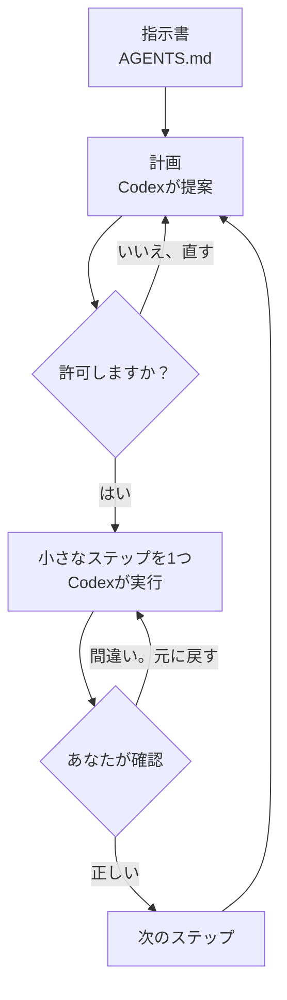

[English](README.md) · **日本語**

# 02：自分のプロジェクトに取り組む

時間：好きなだけ。目標：あなたが主導権を持ち続けられる作業の進め方を身につけることです。

どの作業でも、この流れをくり返します：



## 1. プロジェクトを専用のフォルダに入れる

Codexが必要とするファイル（データ・メモ・下書き）だけを1つのフォルダにコピーして、そのフォルダをCodexで開きます。データファイルは `data` という名前のフォルダに、メモは `notes` という名前のフォルダに入れます。個人的な情報は入れないでください（READMEを見てください）。

## 2. 指示書を書く：`AGENTS.md`

Codexは、作業のたびにその前に、フォルダの中の `AGENTS.md` というファイルを読みます（[公式ガイド](https://learn.chatgpt.com/docs/agent-configuration/agents-md)）。ここには、プロジェクトの内容と、Codexが守るべきルールを書きます。

自分で書く必要はありません。Codexがテンプレートからファイルを作り、あなたにインタビューして中身を埋めてくれます。次をコピーして貼り付けてください：

```text
下のテンプレートをもとに、このフォルダにAGENTS.mdというファイルを作ってください。まず私のファイルを見てください。そのあと、[角かっこ]の部分を「私の問い」も含めてすべて埋めるために、質問を1回に1つずつしてください。どの部分も、あなたが自分で埋めないでください。私が変更を頼まないかぎり、「ルール」の部分はそのままにしてください。終わったら、完成したファイルを見せてください。

# プロジェクトの指示書

## このプロジェクトについて
- テーマ: [ゼミのテーマを1文で]
- 私の問い: [答えたい問い]
- 読み手: [結果を読む人：ゼミ・論文の審査員・クライアントなど]

## ファイル
- data/: [データファイルが何か、どこから来たか]
- notes/: [メモ・下書き・文献リスト]

## ルール
- ファイルを変更する前に、何をするかを説明して、私のOKを待ってください。
- 私の元のデータは、決して削除したり上書きしたりしないでください。結果はoutputs/に保存してください。
- シンプルなPythonかスプレッドシートを使い、コードはわかりやすい日本語で説明してください。
- 報告する数字はすべて、実際に実行したファイルから出したものにしてください。どのファイルかも教えてください。
- 参考文献・引用・統計を決してでっち上げないでください。自信がないときは、そう言ってください。
- プログラミングを知らない人にもわかる日本語で書いてください。
- 作業が終わるたびに、outputs/ai-log.mdに1行追加してください：何をしたか、どのファイルが変わったか。
```

そのあと **New chat**（新しいチャット）を始めて（インタビューで最初のチャットが長くなったためです）、Codexが指示書を読んだかどうかを確かめます：

```text
AGENTS.mdの指示を、5つの箇条書きでまとめてください。
```

## 3. 作業の前に計画を頼む

どう書けばよいかわからないときは、[プロンプトの書き方ガイド](../prompt-guide/README.ja.md)の6つの要素か、そこにあるプロンプト作成役を使ってください。


```text
私の目的は[目的]です。ファイルを変更する前に、短い計画を書いてください：手順、作るファイル、それぞれの結果を私がどう確認できるか、私から必要なもの。スプレッドシートで私が手で確認できる数字を1つ入れてください。私のOKを待ってください。
```

計画を読みます。間違っていたら直します。それから初めて `OK、ステップ1だけやってください。` と伝えます。

## 4. 小さなステップで進める

1回に1つのステップだけを頼み、次に進む前に1つずつ確認します。小さなステップは、確認しやすく、元に戻しやすいです。

## ゼミでよくある作業のプロンプトテンプレート

角かっこの中を書き換えてください。

**データセットを調べる**

```text
[ファイル]を見てください。行と列がいくつあるか、各列が何を意味するか、欠損値やおかしな値はどれか、そしてこのデータで答えられそうな問いを3つ教えてください。ファイルは何も変更しないでください。
```

**データをきれいにしてグラフを作る**

```text
scripts/に短いPythonスクリプトを書いてください。[ファイル]をきれいにし（[直すこと]）、きれいにしたデータをoutputs/に保存し、[何]の[棒/折れ線]グラフをoutputs/[名前].pngとして保存するものです。実行して、主な数字を見せてください。そのうち1つを手で確認する方法も教えてください。
```

**自分のメモから文献の表を作る**

```text
notes/にある私の文献メモを読んでください。outputs/literature.mdに、「著者（年）」「データ」「方法」「主な結果」「私の問いとの関係」の列がある表を作ってください。私のメモにあることだけを使ってください。自信がないものには[CHECK]と印をつけてください。
```

**レポートや発表の構成を作る**

```text
outputs/にある私の結果と私のメモを使って、[10分の発表 / 4,000字のレポート]の構成案を下書きしてください。各セクションについて、何を述べるか、どのファイルがその根拠になるかを1文で書いてください。本文はまだ書かないでください。
```

**ほかの人が書いたコードを説明してもらう**

```text
[スクリプト]が何をしているかを、プログラミングをしたことがない人向けに、1ステップずつ説明してください。そのあと、[私のデータ]で動かすには何を変える必要があるかを教えてください。
```

## または見本のスキルを使う

上のテンプレートの代わりに、[見本のスキル](../skills/README.ja.md)を使うと、作業の流れ全体を実行できます。データファイルには `$data-explore`、アンケートの書き出しファイルには `$survey-summary`、分析結果をスライドにするには `$presentation-page` を使います。インストールは[04：スキルを一歩ずつ（パートA）](../04-make-a-skill/README.ja.md#part-a-install-the-example-skills-5-minutes)で行います。

## うまくいかないとき

- **頼んでいないことをした：** `今のを元に戻して、なぜそうしたのか説明してください。`
- **止まってしまう、または同じことをくり返す：** 新しいチャットを始めて、もっと小さな作業を頼みます。
- **エラーメッセージが出た：** それを貼り付けて、`これはわかりやすい日本語で言うとどういう意味ですか？いちばん小さな修正は何ですか？` と聞きます。
- **結果の意味がわからない：** `クラスメートに説明するように説明してください。`

次へ：[03：確認と申告](../03-verify-and-disclose/README.ja.md)
