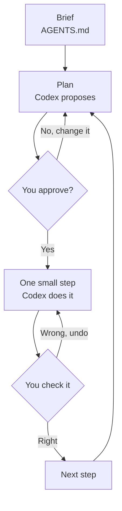

# 02: Work on your own project

Time: as long as you like. Goal: a way of working that keeps you in charge.

The loop for every task:



## 1. Put your project in its own folder

Copy only the files Codex needs (data, notes, drafts) into one folder and
open that folder in Codex. Leave out anything private (see the README).

## 2. Write a brief: `AGENTS.md`

Codex reads a file called `AGENTS.md` in your folder before every task
([official guide](https://learn.chatgpt.com/docs/agent-configuration/agents-md)).
It is where you write what the project is and the rules Codex must follow.

You do not need to write it yourself. Codex creates it from a template and
interviews you to fill it in. Copy and paste:

```text
Create a file called AGENTS.md in this folder from the template below. Then ask me questions one at a time to fill in every part in [square brackets], and keep the Rules section as it is unless I ask to change it. When we are done, show me the finished file.

# Project brief

## What this project is
- Topic: [your seminar topic in one sentence]
- My question: [the question I want to answer]
- Audience: [who will read the result: seminar, thesis examiner, client]

## Files
- data/: [what the data files are, where they came from]
- notes/: [notes, drafts, reading lists]

## Rules
- Explain what you will do and wait for my OK before changing files.
- Never delete or overwrite my original data. Save results in outputs/.
- Use simple Python or spreadsheets and explain code in plain English.
- Every number you report must come from a file you ran; tell me which one.
- Never invent references, quotes or statistics. If you are unsure, say so.
- Write in clear English for a reader who is not a programmer.
```

Then check that Codex read it:

```text
Summarize the instructions in AGENTS.md in five bullet points.
```

## 3. Ask for a plan before any work

Not sure how to phrase it? Use the six parts in the
[prompting guide](../prompt-guide/), or its prompt builder.


```text
I want to [goal]. Before changing any files, write a short plan: the steps, which files you will create, how I can check each result, and anything you need from me. Wait for my OK.
```

Read the plan. Change it if it is wrong. Only then say `OK, do step 1 only.`

## 4. Work in small steps

Ask for one step at a time and check each one before the next. Small steps
are easier to check and easier to undo.

## Prompt templates for common seminar tasks

Replace the parts in square brackets.

**Explore a dataset**

```text
Look at [file]. Tell me how many rows and columns it has, what each column means, which values are missing or strange, and three questions this data could answer. Do not change any files.
```

**Clean data and make a chart**

```text
Write a short Python script in scripts/ that cleans [file] ([what to fix]), saves the cleaned data to outputs/, and makes a [bar/line] chart of [what] saved as outputs/[name].png. Run it, show me the key numbers, and tell me how to check one of them by hand.
```

**Build a literature table from your own notes**

```text
Read my reading notes in notes/. Make a table in outputs/literature.md with columns Author (year), Data, Method, Main finding, and How it relates to my question. Use only what is in my notes. Mark anything you are unsure about with [CHECK].
```

**Outline a report or presentation**

```text
Using my results in outputs/ and my notes, draft an outline for a [10-minute presentation / 2,000-word report] with one sentence per section on what it says and which file supports it. Do not write the full text yet.
```

**Explain code someone else wrote**

```text
Explain what [script] does, step by step, for someone who has never programmed. Then tell me what I would need to change to run it on [my data].
```

## Or use the example skills

Instead of the templates above, the [example skills](../skills/) run whole
workflows: `$data-explore` for a data file, `$survey-summary` for a survey
export, and `$presentation-page` to turn your findings into slides. Install
them with [04: Skills, Part A](../04-make-a-skill/#part-a-install-the-example-skills-5-minutes).

## When something goes wrong

- **It did something you did not ask for:** `Undo that and explain why you did it.`
- **It is stuck or repeats itself:** start a new chat and give a smaller task.
- **An error message:** paste it and ask `What does this mean in plain English, and what is the smallest fix?`
- **You do not understand the result:** `Explain this as if to a classmate.`

Next: [03: Verify and disclose](../03-verify-and-disclose/)
