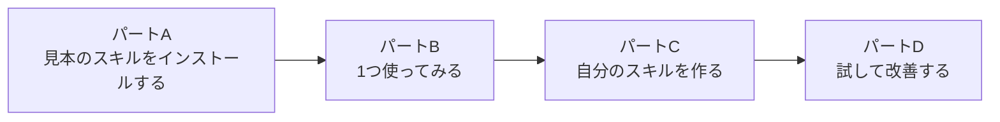
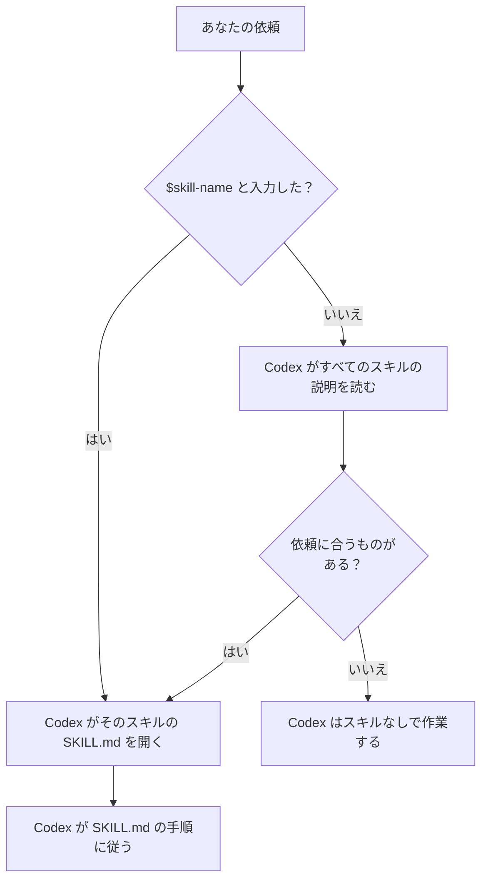

[English](README.md) · **日本語**

# 04：スキルを一歩ずつ

時間：約25分。ファイルを手で作ったり編集したりすることはありません。
どのステップも、プロンプトをコピーして貼り付けるだけです。

**スキル**とは、保存しておくレシピのことです。同じ長い指示を毎回打つ代わりに、
一度だけ保存しておき、`$data-explore` のように名前で呼び出します。
頼んだ内容がスキルに合っていれば、Codex が自分でスキルを選ぶこともあります。



## このワークショップの見本のスキル

| スキル | 何をするか | 使う場所 |
| --- | --- | --- |
| `data-explore` | どんな表データでも → きれいにしたデータ・グラフ・確認済みの分析結果メモ | [99](../99-follow-my-example/README.ja.md)、自分のデータ |
| `survey-summary` | Google フォームの書き出し → 匿名の要約・グラフ・回答の引用 | [98](../98-present-your-work/README.ja.md) |
| `presentation-page` | 分析結果 → オフラインで開けて PDF に保存できる、すっきりしたスライド | [98](../98-present-your-work/README.ja.md)、[99](../99-follow-my-example/README.ja.md) |
| `meeting-notes` | パートC で自分で作ります | ゼミのメモ |

それぞれのレシピは [skills フォルダ](../skills/README.ja.md) で読めます。

---

<a id="part-a-install-the-example-skills-5-minutes"></a>
## パートA：見本のスキルをインストールする（5分）

> 練習コース [98](../98-present-your-work/README.ja.md) と
> [99](../99-follow-my-example/README.ja.md) には、使うスキルがすでに入っています。
> そのため、この2つではパートA を飛ばせます。**自分の**プロジェクトでスキルを
> 使いたいときに、パートA をしてください。

**A1. ファイルを手に入れる。** このリポジトリの GitHub ページで
**Code → Download ZIP**（コード → ZIP をダウンロード）を選び、解凍します。
Codex にダウンロードしてもらうこともできます
（[2つの方法](../README.ja.md#get-the-workshop-files)）。
これで `codex-seminar-main` というフォルダができます。

**A2. そのフォルダを Codex で開く。** ChatGPT のデスクトップアプリで
`codex-seminar-main` フォルダを開き、**Codex** を選びます
（[ステップ00](../00-install/README.ja.md) と同じです）。

**A3. Codex にインストールを頼む。** 次をコピーして貼り付けます。

```text
このプロジェクトの skills/ フォルダにある3つのスキルをインストールしてください。それぞれのスキルのフォルダ（data-explore・survey-summary・presentation-page、中身もすべて）を、ホームフォルダの .agents/skills フォルダにコピーしてください。そのフォルダがなければ作ってください。ほかには何も変更しないでください。終わったら、インストールしたスキルとその場所を一覧にしてください。
```

Codex は**許可を求めてきます**。スキルのフォルダ（ホームフォルダの `.agents`）は、
開いたフォルダの外にあるからです。Codex が何をしようとしているかを読んでから、
許可してください。許可しなければ、何もインストールされません。

**A4. インストールされたか確認する。** **New chat**（新しいチャット）を始めて、
次を貼り付けます。

```text
今使えるスキルはどれですか？それぞれのスキルの名前と、1行の説明を一覧にしてください。
```

**確認：** `data-explore`・`survey-summary`・`presentation-page` が表示されるはずです。
メッセージ欄に `$` と入力するか、アプリのサイドバーで **Skills**（スキル）を開いても
確認できます。（`$` は **Codex** で使えます。ChatGPT の **Work**（作業モード）では、
スキルには `$` ではなく `@` を使います。）

> 表示されませんか？ChatGPT アプリを閉じて開き直し、もう一度 A4 を試してください。
> それでも出てこないときは、インストールが行われていません。A3 に戻って、
> 許可を求められたら許可してください。

あとで98や99のフォルダを開くと、同じスキルが2つ表示されることがあります
（ホームフォルダのものと、コースのフォルダのものです）。これで問題ありません。

**自分のプロジェクトですか？** 次は [02：自分のプロジェクトに取り組む](../02-your-project/README.ja.md) です。
ステップ03のあとで、パートB に戻ってきてください。

---

<a id="part-b-use-a-skill-5-minutes"></a>
## パートB：スキルを使う（5分）

`codex-seminar-main` の中にある `99-follow-my-example` フォルダを Codex で開き、
次を貼り付けます。

```text
$data-explore このデータについて、わかりやすい日本語で説明だけしてください（スキルのステップ1）。まだ何もインストール・計算・作成しないでください。
```

スキルによって Codex が何をするかを見てください。頼んでいないのに、すべての列を
一覧にし、`AGENTS.md` の指示書を使って、それぞれの列の意味を説明します。
**これがスキルの役割です。**（スキル全体では、空欄・ゼロ・おかしな値も数えます。
それはコース99で行うので、ここでは短い確認だけにして利用枠を節約します。）

Codex がスキルを使うかどうかを決める流れです。



---

## パートC：自分のスキルを作る（10分）

`meeting-notes` を作ります。ゼミの雑なメモを、決まったことと、やることを含む
きれいな要約にするスキルです。くり返している作業なら、何に置き換えてもかまいません
（最後のアイデアを見てください）。

**C1. 練習用のフォルダを開く。** [ステップ00](../00-install/README.ja.md) の
`codex-practice` フォルダか、どれかのプロジェクトのフォルダを使います。

**C2. スキル作成のスキルに頼む。** Codex には、スキルを作るためのスキルが
最初から入っています。次をコピーして貼り付けます。

```text
$skill-creator meeting-notes という名前の新しいスキルを作りたいです。ゼミのミーティングの雑なメモを、きれいな要約にして、元のファイルの隣に保存するスキルです。要約は3つの部分でできています。5行の要約、決まったことの一覧、そして「タスク」「担当」「期限」の列があるやること（アクションアイテム）の表です。メモにないタスク・名前・日付は、絶対に作り出してはいけません。はっきりしないことには [CHECK] と印をつけます。「来週までに」のようなあいまいな日付は、書かれたとおりに写して [CHECK] と印をつけます。要約のファイルがすでにある場合は、置き換える前に確認します。ミーティングのメモを要約・整理・清書してほしいと頼んだときに使い、ほかの文書には使いません。スクリプトは使わず、指示だけのスキルにしてください。どのプロジェクトでも使えるように、ホームフォルダの .agents/skills に保存してください。
```

Codex は、保護されたフォルダである `.agents` にスキルを保存するための
**許可**を求めてきます。許可してください。

**確認：** Codex の返事に、スキルを `.agents/skills/meeting-notes` に保存したと
書かれているはずです。保存できなかった、またはほかの場所に保存したと書かれていたら、
次のように返事をします。
`ホームフォルダの .agents/skills/meeting-notes に保存してください。保存する前に私に許可を求めてください。`

**C3. 質問に答える。** スキル作成のスキルは、先にいくつか質問をすることもあれば、
すぐにスキルを書き始めることもあります。どちらでも大丈夫です。
答え方の例です。

| Codex に聞かれたら… | こう答えられます… |
| --- | --- |
| スキルは何をしますか？ | （プロンプトにもう書いてあります。）雑なミーティングのメモを、要約・決まったこと・やることの表にします。 |
| いつ使いますか？ | ミーティングのメモを要約・整理・清書してほしいと頼んだときです。ほかの文書には使いません。 |
| 指示だけですか、スクリプトも使いますか？ | 指示だけです。 |
| どこに保存しますか？ | どのプロジェクトでも使えるように、ホームフォルダの `.agents/skills` に保存します。 |
| 絶対にしてはいけないことはありますか？ | タスク・名前・日付を作り出さないこと。はっきりしないことには [CHECK] と印をつけること。 |

**C4. できたものを見る。** 次を貼り付けます。

```text
meeting-notes 用に作った SKILL.md ファイルを見せてください。そして、それぞれの部分（name・description・手順）を、わかりやすい日本語で説明してください。
```

**description**（説明）がいちばん大事な行です。Codex はこれを読んで、
いつスキルを使うかを決めます。

---

## パートD：試して改善する（5分）

**D1. 試すための雑なメモを作る。** **New chat** を始めて、次を貼り付けます。

```text
notes/meeting-1.md というファイルを作ってください。中身は、観光アンケートのプロジェクトについての、30分の学生ゼミのミーティングの、現実にありそうな雑なメモにしてください。条件は次のとおりです。文が途中で切れている。3人（Aiko・Ben・Chen）が出てくる。決まったことが2つ、タスクが4つある。締め切りが1つ、あいまいに書かれている（「来週までに」）。決まったこととタスクは、見出しや箇条書きにせず、メモの流れの中に混ぜてください。
```

**D2. 名前でスキルを呼び出す。**

```text
$meeting-notes notes/meeting-1.md
```

**確認：** 4つのタスクがすべて入っていますか？あいまいな締め切りは、日付を
作り出さずに `[CHECK]` と印がついていますか？

**D3. 名前を使わずに試す。** **New chat** を始めて、次を貼り付けます。

```text
notes/meeting-1.md のミーティングのメモを整理してもらえますか？
```

Codex は自分で `meeting-notes` を使いましたか？使わなかったら、
description を改善します。

```text
私の meeting-notes スキルの description を改善して、ミーティングのメモを要約・整理・清書・まとめてほしいと頼んだときには、いつもこのスキルが使われるようにしてください。新しい description を見せてください。
```

Codex はスキルのファイルを変更するための許可を求めてきます。許可してください。

**D4. することを変える。** スキルはかんたんに更新できます。**New chat** を
始めてから（長いチャットは利用枠を多く使います）、次を貼り付けます。

```text
私の meeting-notes スキルを変更して、やることの表に「状況」の列も加えてください。最初の値は「未着手」にします。何が変わったかを見せてください。
```

Codex はスキルのファイルを変更するための許可を求めてきます。許可してください。
そのあと、もう一度 D2 を実行して、変化を確かめます。

---

## 自分のスキルのアイデア

| スキル | できそうなこと |
| --- | --- |
| `literature-table` | 文献の読書メモ → 著者・データ・方法・結果の表。確かでないところには [CHECK] と印をつける |
| `citation-check` | 下書きの参考文献をすべて一覧にし、DOI・URL・ページ番号がないものに印をつける。印のついたものは自分で確認する |
| `email-to-professor` | 伝えたいことを、短く丁寧なメールの下書きにする。下書きは自分で手直しする |
| `weekly-log` | `notes/` の中で、この7日間に変更したファイルから、今週したことをまとめる |

## よいスキルとは

- **1つの仕事だけをする。** ミーティングのメモに1つ、文献に別の1つ。
- **いつ使うかが、description にはっきり書いてある。**
- **事実に厳しい。** 「絶対に作り出さない…」というルールをスキルの中に書いておくと、
  毎回そのルールが守られます。

## うまくいかないとき

- **スキルが一覧に出てこない：** ChatGPT アプリを閉じて開き直します。
- **Codex がスキルを書けないと言う：** スキルのフォルダ `.agents` は、ホームフォルダでも
  プロジェクトでも保護されています。Codex に許可を求められたら、許可してください。
  聞かれなかったときは、次のように返事をします。
  `許可を求めてから、もう一度試してください。`
- **手順どおりにしない：** `私の meeting-notes スキルをもう一度読んで、どの手順を飛ばしたか教えてください。`

次は、[98：成果を発表する](../98-present-your-work/README.ja.md)
か [99：私の例をなぞる](../99-follow-my-example/README.ja.md) でスキルを使います。
