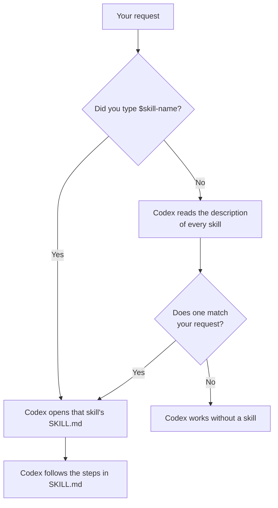

# 04: Make a skill

Time: about 10 minutes.

If you find yourself typing the same long instructions again and again,
save them as a **skill**. A skill is a folder with a `SKILL.md` file that
tells Codex how to do one job. Next time you just call it by name.
([Official guide](https://learn.chatgpt.com/docs/build-skills))

```
your-project/
└── .agents/
    └── skills/
        └── literature-table/
            └── SKILL.md      ← required: name, description, instructions
```

Codex looks for skills in `.agents/skills/` inside your project folder (and
in `~/.agents/skills/` for skills you want in every project).

## How Codex uses a skill

- **When you call it:** type `$` and the skill name, for example
  `$literature-table`.
- **When it matches:** Codex reads every skill's `description` and may use a
  skill on its own when your request fits. So the description must say
  clearly when to use it, and when not to.

## How Codex decides to use a skill



This is why the `description` matters: it is the only part Codex reads
before deciding.

## Way 1: let Codex write it (easiest)

Codex has a built-in skill for making skills. Copy and paste, then edit the
part in square brackets:

```text
$skill-creator Create a skill called literature-table for this project. It should read my reading notes in notes/ and build a table in outputs/literature.md with columns Author (year), Data, Method, Main finding, and How it relates to my question. Rules: use only what is in my notes, never invent a reference, and mark anything uncertain with [CHECK]. It should trigger when I ask for a literature table or a summary of my readings, and not for anything else. Keep it instruction-only, with no scripts.
```

Codex asks a few questions, then saves the skill in `.agents/skills/`.

## Way 2: write it yourself

Create the file `.agents/skills/literature-table/SKILL.md` with:

```md
---
name: literature-table
description: Build a literature table from the reading notes in notes/. Use when the user asks for a literature table or a summary of their readings. Do not use for writing new text or finding new sources.
---

# Literature table

1. Read every file in notes/.
2. For each source, record: Author (year), Data, Method, Main finding,
   and How it relates to the research question in AGENTS.md.
3. Use only what is written in the notes. Never invent a reference,
   year or finding. Mark anything uncertain with [CHECK].
4. Save the table as outputs/literature.md, sorted by author.
5. Tell the user how many sources you found and list every [CHECK].
```

Codex notices new or changed skills automatically. If it does not show up,
restart the app.

## Test it

Start a **new chat** and type:

```text
$literature-table
```

Then test whether the description works by asking without the name:

```text
Can you summarize my readings in a table?
```

If Codex does not use the skill, make the `description` clearer.

## Good skills are

- **About one job.** One skill for the literature table, another for
  charts.
- **Written as steps,** with clear inputs (which files) and outputs (which
  file to save).
- **Strict about facts.** Put your verification rules inside the skill so
  they run every time.

Want a worked example with data? The [follow-my-example track](../99-follow-my-example/)
ends by turning the analysis into a `coverage-check` skill.
