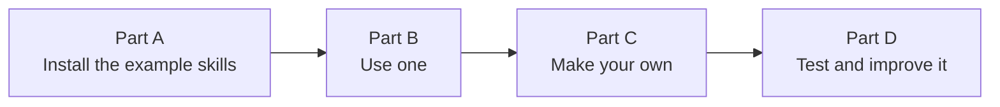
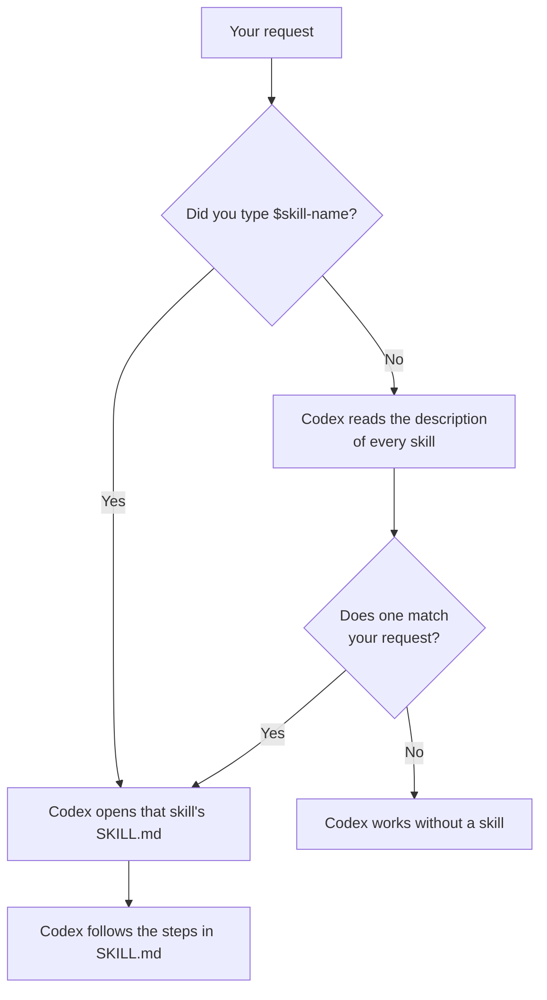

# 04: Skills, step by step

Time: about 25 minutes. You will not create or edit any file by hand:
every step is a prompt you copy and paste.

A **skill** is a saved recipe. Instead of typing the same long
instructions every time, you save them once and call them by name, like
`$data-explore`. Codex can also pick a skill by itself when your request
matches it.



## The example skills in this workshop

| Skill | What it does | Used in |
| --- | --- | --- |
| `data-explore` | Any spreadsheet → cleaned data, charts and a checked findings memo | [99](../99-follow-my-example/), your own data |
| `survey-summary` | A Google Forms export → anonymous summary, charts and quotes | [98](../98-present-your-work/) |
| `presentation-page` | Your findings → a clean slide deck you can open offline and save as PDF | [98](../98-present-your-work/), [99](../99-follow-my-example/) |
| `meeting-notes` | You make this one in Part C | Your seminar notes |

You can read each recipe in the [skills folder](../skills/).

---

## Part A: Install the example skills (5 minutes)

> The practice tracks [98](../98-present-your-work/) and
> [99](../99-follow-my-example/) already include their skills, so you can
> skip Part A for them. Do Part A to use the skills in **your own**
> projects.

**A1. Get the files.** On this repository's GitHub page choose
**Code → Download ZIP**, then unzip it, or let Codex download it
([two ways](../#get-the-workshop-files)). You now have a folder called
`codex-seminar-main`.

<!-- Screenshot to add:  -->

**A2. Open that folder in Codex.** In the ChatGPT desktop app, open the
folder `codex-seminar-main` and choose **Codex** (as in
[step 00](../00-install/)).

**A3. Ask Codex to install them.** Copy and paste:

```text
Install the three skills in the skills/ folder of this project for me. Copy each skill folder (data-explore, survey-summary and presentation-page, with everything inside them) into the folder .agents/skills in my home folder, and create that folder if it does not exist. Do not change anything else. When you are done, list the skills you installed and where.
```

Codex **will ask for your permission**, because the skills folder
(`.agents` in your home folder) is outside the folder you opened. Read what it wants to do,
then approve. If you do not approve, nothing is installed.

<!-- Screenshot to add:  -->

**A4. Check they are installed.** Start a **New chat** and paste:

```text
Which skills can you use right now? List each skill's name and its one-line description.
```

**Check:** You should see `data-explore`, `survey-summary` and
`presentation-page`. You can also type `$` in the message box, or open
**Skills** in the app's sidebar, to see them. (`$` works in **Codex**. In
ChatGPT **Work** mode, skills use `@` instead.)

> Not there? Close and reopen the ChatGPT app, then try A4 again.

If you open folder 98 or 99 later, Codex may list a skill twice (the copy in
your home folder and the one in the track folder). That is fine.

**Own project?** Your next step is [02: Work on your own project](../02-your-project/).
Come back for Part B after step 03.

---

## Part B: Use a skill (5 minutes)

Open the folder `99-follow-my-example` (inside `codex-seminar-main`) in
Codex and paste:

```text
$data-explore Only describe this data in plain English (step 1 of the skill). Do not install, calculate or create anything yet.
```

Watch what the skill makes Codex do: it lists every column and flags
blanks, zeros and odd values, without you asking for any of that. **That is
what a skill is for.** (Track 99 runs the full analysis, so this short
check saves your usage.)

How Codex decides to use a skill:



---

## Part C: Make your own skill (10 minutes)

We will make `meeting-notes`: it turns messy seminar notes into a clean
summary with decisions and action items. You can swap in any task you
repeat (see the ideas at the end).

**C1. Open a practice folder.** Use the `codex-practice` folder from
[step 00](../00-install/), or any project folder.

**C2. Ask the skill creator.** Codex has a built-in skill that makes
skills. Copy and paste:

```text
$skill-creator I want a new skill called meeting-notes. It turns my rough seminar meeting notes into a clean summary saved next to the original, with three parts: a five-line summary, a list of decisions, and a table of action items with columns Task, Who and By when. It must never invent tasks, names or dates that are not in my notes; if something is unclear, it marks it with [CHECK]. It should be used when I ask to summarize, tidy or clean up meeting notes, and not for other documents. Keep it instruction-only, with no scripts. Save it in my home folder's .agents/skills so I can use it in every project.
```

Codex will ask **permission** to save the skill in `.agents`, a protected
folder. Approve it.

**C3. Answer its questions.** The skill creator may ask a few questions
first. Suggested answers:

| If Codex asks... | You can answer... |
| --- | --- |
| What should the skill do? | (Already in your prompt.) Turn rough meeting notes into a summary, decisions and an action-item table. |
| When should it trigger? | When I ask to summarize, tidy or clean up meeting notes. Not for other documents. |
| Instructions only, or scripts too? | Instructions only. |
| Where should it be saved? | In my home folder's `.agents/skills`, so it works in every project. |
| Anything it must never do? | Never invent tasks, names or dates. Mark anything unclear with [CHECK]. |

**C4. Look at what it made.** Paste:

```text
Show me the SKILL.md file you created for meeting-notes and explain each part in plain English: the name, the description, and the steps.
```

The **description** is the most important line: it is what Codex reads to
decide when to use the skill.

---

## Part D: Test and improve it (5 minutes)

**D1. Make some messy notes to test with.** Start a **New chat** and
paste:

```text
Create a file notes/meeting-1.md with realistic but messy notes from a 30-minute student seminar meeting about a tourism survey project: half sentences, three people (Aiko, Ben, Chen), two decisions, four tasks, one deadline mentioned vaguely ("before next week").
```

**D2. Call your skill by name.**

```text
$meeting-notes notes/meeting-1.md
```

**Check:** Are all four tasks there? Did it mark the vague deadline with
`[CHECK]` instead of inventing a date?

**D3. Test it without the name.** Start a **New chat** and paste:

```text
Can you tidy up the meeting notes in notes/meeting-1.md?
```

Did Codex use `meeting-notes` on its own? If not, improve the
description:

```text
Improve the description of my meeting-notes skill so it is used whenever I ask to summarize, tidy, clean up or organize meeting notes. Show me the new description.
```

**D4. Change what it does.** Skills are easy to update:

```text
Change my meeting-notes skill so the action-item table also has a Status column that starts as "To do". Show me what changed.
```

Then run D2 again to see the change.

---

## Ideas for your own skills

| Skill | What it could do |
| --- | --- |
| `literature-table` | Reading notes → a table of author, data, method and finding, marking anything unsure with [CHECK] |
| `citation-check` | List every reference in a draft and the ones you still need to verify |
| `email-to-professor` | Turn your points into a short, polite email draft for you to edit |
| `weekly-log` | Summarize what you did this week from your notes and files |

## Good skills are

- **About one job.** One skill for meeting notes, another for literature.
- **Clear about when to trigger,** in the description.
- **Strict about facts.** Put "never invent..." rules inside the skill so
  they apply every time.

## If something goes wrong

- **The skill is not listed:** close and reopen the ChatGPT app.
- **Codex says it cannot write to your home folder:** approve the
  permission request, or ask it to install the skill into this project
  instead: `Install it into .agents/skills in this project folder instead.`
- **It does not follow the steps:** `Read my meeting-notes skill again and tell me which step you skipped.`

Next: use the skills in [98: Present your work](../98-present-your-work/)
or [99: Follow my example](../99-follow-my-example/).
