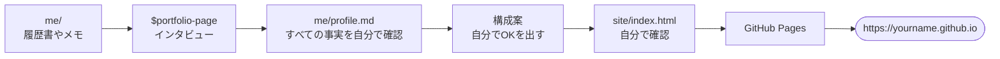

[English](README.md) · **日本語**

# 97：ポートフォリオサイトを公開する（授業のあと）

就職活動（就活）用の1ページのポートフォリオサイトを作り、無料でネットに公開します。アドレスは `https://yourname.github.io` のような形になります。授業のあとに自分の時間で進めます。かかる時間は約2時間です。どのステップのあとでも、そこでやめてかまいません。

参考に、発表者自身のポートフォリオを見てください：
[pannphetra.com](https://pannphetra.com)。



| ステップ | やること | 時間 |
| --- | --- | --: |
| 1 | 見本を見る | 5分 |
| 2 | 材料を集める | 15分 |
| 3 | Codex にインタビューしてもらう | 20分 |
| 4 | サイトを作る | 15分 |
| 5 | 自分で確認する | 15分 |
| 6 | GitHub Pages で公開する | 20分 |
| 7 | 使う・最新の状態に保つ | いつでも |

## 始める前に

- [00：インストールとサインイン](../00-install/README.ja.md) と
  [01：最初の作業](../01-first-task/README.ja.md) を終えておきます。
- ワークショップのファイルを手に入れます（[ワークショップのファイルを手に入れる](../README.ja.md#get-the-workshop-files)）。
- ChatGPT デスクトップアプリで、フォルダ **`97-portfolio-site`**
  （`codex-seminar-main` の中）を開き、**Codex** を選びます。`portfolio-page`
  スキルはこのフォルダの中にすでに入っています。Python は必要ありません。

> **プライバシー：** あなたのサイトは公開されます。企業の人を含め、だれでも読めます。電話番号・住所・生年月日・学籍番号・マイナンバー・成績・他人の写真は、絶対に載せないでください。

## ステップ1：見本を見る（5分）

`example/index.html` をダブルクリックします。ネット上でも開けます：
[見本のサイト](https://pann13223029.github.io/codex-seminar/97-portfolio-site/example/)。
これは架空の学生のサイトで、`example/profile.md` から作りました。**EN / 日本語** ボタンを押してみてください。ウィンドウの幅を狭くすると、スマートフォンでの見え方がわかります。あなたのサイトも、同じ部分でできています：

| 部分 | 書く内容 |
| --- | --- |
| 希望 | 希望する仕事と、働き始められる時期 |
| ひとこと紹介 | 1〜2文。何をしている人か、そして結果を1つ |
| 3つの数字 | 面接で説明できる証拠 |
| 実績 | 2〜4つのエピソード。課題・取り組み・結果 |
| 経歴・スキル・連絡先 | 短く、本当のことだけ |

## ステップ2：材料を集める（15分）

手元にあるものを `me` フォルダに入れます。履歴書（PDF・Word・テキスト）、ゼミの研究・アルバイト・サークル・インターンについてのメモなどです。履歴書がなくても大丈夫です。Codex が質問してくれます。

エピソードを2〜4つ考えます。それぞれについて、次のことを書き出します：

- **課題：** 何が問題でしたか。何が必要でしたか。
- **取り組み：** チームではなく、**あなた**は何をしましたか。
- **結果：** 何が変わりましたか。数字があるなら、その数字はどうやってわかりましたか。

## ステップ3：Codex にインタビューしてもらう（20分）

**New chat**（新しいチャット）を始めて、次を貼り付けます（角かっこの部分は書き換えてください）：

```text
$portfolio-page ポートフォリオサイト用に me/profile.md を埋めたいので、私にインタビューしてください。私は[希望する仕事の種類]を探していて、[年と月]から働き始めたいです。me/ にファイルがあれば使ってください。質問は1つずつしてください。
```

Codex は質問を1つずつ、全部で10個ほどします。英語でも日本語でもかまいません。自分の言葉で答えてください。答え方の例：

| Codex がこう聞いてきたら… | こう答えられます… |
| --- | --- |
| あなたが持っていない数字 | `これには数字がありません。言葉で書いてください。` |
| 自信がないこと | `[ADD] と書いておいてください。あとで確認します。` |
| エピソードを大げさにする提案 | `いいえ。私が言ったとおりにしてください。` |

Codex が完成したプロフィールを見せたら、読んでから
`OK、保存してください。` と返信します。

**確認：** `me/profile.md` を開きます。すべての行が本当のことですか。あなたが言っていないスキルや言葉を Codex が足していませんか。足していたら消してください。それぞれの数字を面接で説明できますか。間違いがあれば直します：
`me/profile.md の[ここ]を[こう]に変えてください。ほかは何も変えないでください。`

## ステップ4：サイトを作る（15分）

**New chat** を始めて（利用枠の消費が少なくなります）、次を貼り付けます：

```text
$portfolio-page me/profile.md から私のサイトを作ってください。テーマ：[editorial、bold、field のどれか]。言語：[英語のみ、または英語と日本語]。
```

| テーマ | 雰囲気 |
| --- | --- |
| `editorial` | オフホワイトに濃い青のアクセント。ほとんどの仕事に合います。 |
| `bold` | 暗い背景に琥珀色のアクセント。クリエイティブ職や IT 職向け。 |
| `field` | 明るい灰緑色に深い緑のアクセント。観光・環境・地域の仕事向け。 |

Codex はまず**構成案**を見せます。希望する仕事がいちばん上にあるか、その仕事にいちばん合うエピソードが最初にあるか、すべての数字がプロフィールにあるものか、を確認します。それから `OK` と返信します。（先にプロフィールの確認を求められたら、それにも `OK` と返信します。）

## ステップ5：自分で確認する（15分）

1. `site/index.html` をダブルクリックします。ウィンドウの幅を狭くして、スマートフォンでの見え方を確認します。
2. すべての文を読みます。本当のことですか。あなたらしいですか。
3. ページ内を検索して（`Ctrl F` または `⌘ F`）、電話番号・住所・誕生日・学籍番号・`[ADD]` を探します。**EN / 日本語** を押して、もう一度検索します。何も見つからなければ大丈夫です。
4. メールアドレスとリンクをクリックしてみます。
5. 日本語版がある場合：日本語が母語の人に日本語版を読んでもらいます。
6. 友だちか指導教員に「私はどんな仕事をしたくて、何ができる人だと思う？」と聞きます。30秒で答えられなければ、ページの上の部分をもっとわかりやすくします。

修正は短いプロンプトでできます。例：
`site/index.html のひとこと紹介を「[あなたの文]」に変えてください。ほかは何も変えないでください。`

## ステップ6：GitHub Pages で公開する（20分）

GitHub Pages は、あなたのサイトを無料で公開してくれます。この部分は Codex ではなく、Web ブラウザで行います。

**6.1 GitHub アカウントを作ります。** [github.com](https://github.com/signup) で作ります。
**ユーザー名がそのままサイトのアドレスになります**
（`https://username.github.io`）。自分の名前など、仕事にふさわしいものを選んでください。次に、右上のプロフィール画像 → **Settings**（設定）→
**Emails**（メール）を開き、**Keep my email addresses private**（メールアドレスを非公開にする）にチェックを入れます。これで隠れるのは GitHub の記録の中のメールアドレスだけです。サイトに載せたメールアドレスは見えたままなので、企業に知られてもよいアドレスを使ってください。

**6.2 サイト用のリポジトリを作ります。**

1. 右上の **+** → **New repository**（新しいリポジトリ）。
2. Repository name（リポジトリ名）：**`username.github.io`**。自分のユーザー名を正確に入れます
   （例：`mikatanaka.github.io`）。
3. **Public**（公開）を選び、**Add README**（README を追加）をオンにします。
4. **Create repository**（リポジトリを作成）をクリックします。

**6.3 サイトをアップロードします。**

1. 新しいリポジトリで **Add file**（ファイルを追加）→ **Upload files**（ファイルをアップロード）をクリックします。
2. パソコンで `site` フォルダを開き（場所は
   `codex-seminar-main/97-portfolio-site/site`）、**中にあるものすべて**
   （`index.html` と写真があれば写真）を選んで、ページにドラッグします。`site` フォルダそのものではなく、中のファイルをアップロードします。**`me` フォルダは絶対にアップロードしないでください。**
3. **Commit changes**（変更を確定）をクリックします。

**6.4 Pages をオンにします。**

1. リポジトリの **Settings**（設定）タブをクリックします（プロフィール画像の下ではなく、リポジトリのページの上にあるタブです）。次に、左側の **Pages** をクリックします。
2. **Build and deployment**（ビルドとデプロイ）の **Source**（ソース）で **Deploy from a
   branch**（ブランチから公開）を選びます。**Branch**（ブランチ）で **main** と **/ (root)** を選び、**Save**（保存）を押します。
   すでに **main** と表示されていれば、そのまま6.5に進みます。

**6.5 サイトを見てみます。** `https://username.github.io` を開きます。初めて表示されるまで、最大10分かかることがあります
（[GitHub のガイド](https://docs.github.com/en/pages/quickstart)）。スマートフォンでも開いてみてください。

> うまくいかないときは、見えているものを説明して Codex に聞きます：
> `site/index.html を GitHub Pages で公開しようとしています。[見えているもの]が表示されています。どうすればよいですか？わかりやすく説明してください。`

## ステップ7：使う・最新の状態に保つ

**使う：** アドレスを履歴書・LinkedIn のプロフィール・メールの署名に載せます。応募フォームに URL 欄があれば、そこにも入れます。

**更新する：** Codex で `site/index.html` を直し、確認します（ステップ5）。それから GitHub で **Add file** → **Upload files** → 新しい `index.html` をドラッグ →
**Commit changes** の順に進みます。新しいファイルが古いファイルと置き換わります。

**就活用の下書き（任意）：** プロフィールは、自己PRやガクチカ（学生時代に力を入れたこと）の材料にもなります。Codex に下書きを作ってもらい、それを自分で書き直せます：

```text
me/profile.md にある事実だけを使って、[会社名または職種]向けに400字程度の自己PRを下書きしてください。プロフィールにないことは何も足さないでください。あとで自分の言葉で書き直します。
```

提出する前に、必ず自分で書き直してください。面接では、すべての文について質問されます。

**自分のドメイン（任意）：** `yourname.com` のような短いアドレスは、毎年少しの料金がかかります。つなぎ方は GitHub が説明しています：
[カスタムドメイン](https://docs.github.com/en/pages/configuring-a-custom-domain-for-your-github-pages-site)。
