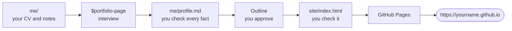

# 97: Your portfolio site, live (after class)

Build a one-page portfolio website for job hunting and put it online for
free, at an address like `https://yourname.github.io`. You do this on your
own time, in about two hours, and you can stop after any step.

For inspiration, see the presenter's own portfolio:
[pannphetra.com](https://pannphetra.com).



| Step | What you do | Time |
| --- | --- | --: |
| 1 | Look at the example | 5 min |
| 2 | Collect your material | 15 min |
| 3 | Let Codex interview you | 20 min |
| 4 | Build the site | 15 min |
| 5 | Check it yourself | 15 min |
| 6 | Go live on GitHub Pages | 20 min |
| 7 | Use it and keep it up to date | any time |

## Before you start

- Finish [00: Install and sign in](../00-install/) and
  [01: Your first task](../01-first-task/).
- Get the workshop files ([Get the workshop files](../#get-the-workshop-files)).
- In the ChatGPT desktop app, open the folder **`97-portfolio-site`**
  (inside `codex-seminar-main`) and choose **Codex**. The `portfolio-page`
  skill is already inside this folder. No Python needed.

> **Privacy:** your site is public. Anyone, including employers, can read
> it. Never put your phone number, home address, date of birth, student ID,
> My Number, grades or photos of other people on it.

## Step 1: Look at the example (5 minutes)

Double-click `example/index.html`, or open it online:
[the example site](https://pann13223029.github.io/codex-seminar/97-portfolio-site/example/).
It is the site of a fictional student, made from `example/profile.md`. Try the **EN / 日本語** button, and make the
window narrow to see how it looks on a phone. Your site will have the same
parts:

| Part | What it says |
| --- | --- |
| Looking for | The job you want and when you can start |
| Pitch | One or two sentences: what you do, and one result |
| Three numbers | Proof you can explain in an interview |
| Selected work | 2 to 4 stories: problem, what I did, result |
| Experience, skills, contact | Short and true |

## Step 2: Collect your material (15 minutes)

Put what you have into the `me` folder: a CV (PDF, Word or text), notes
about your seminar project, part-time job, club or internship. No CV? That
is fine: Codex will ask you.

Think about 2 to 4 stories. For each one, write down:

- **Problem:** what was wrong or needed?
- **What I did:** what did **you** do, not the team?
- **Result:** what changed? If you have a number, how do you know it?

## Step 3: Let Codex interview you (20 minutes)

Start a **New chat** and paste (change the parts in square brackets):

```text
$portfolio-page Interview me to fill in me/profile.md for my portfolio site. I am looking for [the kind of job] starting [month and year]. Use my files in me/ if there are any. Ask one question at a time.
```

Codex asks one question at a time, about ten in all. Answer in your own
words, in English or Japanese. Suggested answers:

| If Codex asks... | You can answer... |
| --- | --- |
| A number you do not have | `I do not have a number for this. Use words.` |
| Something you are not sure about | `Mark it [ADD]. I will check.` |
| To make a story sound bigger | `No. Keep it exactly as I said.` |

When Codex shows your finished profile, read it, then reply
`OK, save it.`

**Check:** open `me/profile.md`. Is every line true? Did Codex add any
skill or word you did not say? Remove it. Could you explain each
number in an interview? Fix anything that is wrong:
`In me/profile.md, change [this] to [that]. Change nothing else.`

## Step 4: Build the site (15 minutes)

Start a **New chat** (it uses less of your allowance) and paste:

```text
$portfolio-page Build my site from me/profile.md. Theme: [editorial, bold or field]. Language: [English only, or English and Japanese].
```

| Theme | Feel |
| --- | --- |
| `editorial` | Off-white, deep blue accent. Fits most jobs. |
| `bold` | Dark background, amber accent. Creative and tech roles. |
| `field` | Light green-grey, forest green accent. Tourism, environment, community. |

Codex first shows an **outline**. Check that the job you want is at the
top, the story that fits it best comes first, and every number is from your
profile. Then reply `OK`. (If Codex first asks you to confirm your profile,
reply `OK` to that too.)

## Step 5: Check it yourself (15 minutes)

1. Double-click `site/index.html`. Make the window narrow to see the phone
   layout.
2. Read every sentence. Is it true? Is it you?
3. Search the page (`Ctrl F` or `⌘ F`) for your phone number, address,
   birthday, student ID and `[ADD]`. Click **EN / 日本語** and search
   again. Nothing should be found.
4. Click your email and links.
5. With Japanese: ask a native speaker to read the Japanese version.
6. Ask a friend or your supervisor: "What job do I want, and what can I
   do?" If they cannot answer in 30 seconds, make the top clearer.

Change things with short prompts, for example:
`In site/index.html, change the pitch to: "[your sentence]". Change nothing else.`

## Step 6: Go live on GitHub Pages (20 minutes)

GitHub Pages hosts your site for free. You do this part in your web
browser, not in Codex.

**6.1 Create a GitHub account** at [github.com](https://github.com/signup).
Your **username becomes your web address**
(`https://username.github.io`), so choose a professional one, such as your
name. Then click your profile picture (top right) → **Settings** →
**Emails**, and tick **Keep my email addresses private**. This hides your
email in GitHub's records only; the email on your site stays visible, so
use an address you are happy to share with employers.

**6.2 Create the website repository.**

1. Top right: **+** → **New repository**.
2. Repository name: **`username.github.io`**, with your exact username
   (for example `mikatanaka.github.io`).
3. Choose **Public**, and turn **Add README** on.
4. Click **Create repository**.

**6.3 Upload your site.**

1. In the new repository, click **Add file** → **Upload files**.
2. Open your `site` folder on your laptop (it is in
   `codex-seminar-main/97-portfolio-site/site`), select **everything inside
   it** (`index.html` and any photos), and drag it onto the page. Upload the
   files, not the `site` folder itself. **Never upload the `me` folder.**
3. Click **Commit changes**.

**6.4 Turn on Pages.**

1. In your repository, click the **Settings** tab (at the top of the
   repository page, not under your profile picture), then **Pages** on the
   left.
2. Under **Build and deployment**, **Source**: choose **Deploy from a
   branch**. **Branch**: choose **main** and **/ (root)**, then **Save**.
   If it already shows **main**, go straight to 6.5.

**6.5 Visit your site.** Open `https://username.github.io`. It can take up
to 10 minutes to appear the first time
([GitHub's guide](https://docs.github.com/en/pages/quickstart)). Open it on
your phone too.

> Stuck? Ask Codex, and describe what you see:
> `I am publishing site/index.html on GitHub Pages. I see [what you see]. What should I do? Explain it simply.`

## Step 7: Use it and keep it up to date

**Use it:** put the address on your CV, in your LinkedIn profile, in your
email signature, and in the URL field of applications that have one.

**Update it:** change `site/index.html` with Codex, check it (Step 5), then
on GitHub: **Add file** → **Upload files** → drag the new `index.html` →
**Commit changes**. The new file replaces the old one.

**Job-hunting drafts (optional):** your profile is also raw material for a
self-PR (自己PR) and gakuchika (ガクチカ). Codex can draft one for you to
rewrite:

```text
Using only the facts in me/profile.md, draft a self-PR of about 400 Japanese characters for [company or job type]. Do not add anything that is not in my profile. I will rewrite it in my own words.
```

Rewrite it yourself before you send it: interviewers will ask about every
sentence.

**Your own domain (optional):** a short address like `yourname.com` costs a
small yearly fee. GitHub explains how to connect one:
[custom domains](https://docs.github.com/en/pages/configuring-a-custom-domain-for-your-github-pages-site).
