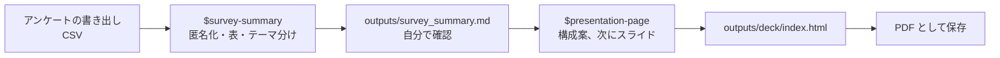

[English](README.md) · **日本語**

# 98：成果を発表する

アンケートを、短くて見やすい発表スライドにします。約40分で、見本のスキルを2つ使います。プログラミングは必要ありません。

使うのは、別府を訪れた観光客への**架空の**（作りものの）アンケートです。形は Google フォームから書き出したデータとまったく同じで、本物のデータに入っているメールアドレスも含まれています。あとで、自分のアンケートで同じ手順を行うこともできます。



## 始める前に

- ワークショップのファイルを手に入れます。ZIP をダウンロードするか、Codex にダウンロードしてもらいます
  （[ワークショップのファイルを手に入れる](../README.ja.md#get-the-workshop-files)）。
- ChatGPT アプリで、フォルダ **`98-present-your-work`**（`codex-seminar-main` の中）を開き、**Codex** を選びます。
- インストールするものはありません。このフォルダには、使う2つのスキルがすでに入っています。場所は隠しフォルダ `.agents/skills` です。次のように聞いて確認します：
  `今使えるスキルは何ですか？名前を一覧にしてください。`
  `survey-summary` と `presentation-page` が表示されれば大丈夫です（ほかにもたくさん表示されることがあります）。
- [Python の確認](../00-install/README.ja.md#get-ready-for-the-data-tracks-python)
  を一度行っておきます。pandas をインストールするためにインターネットを使う許可を Codex に求められたら、許可してください。

## ステップ1：指示書を確認する（2分）

```text
AGENTS.md を読んで、プロジェクト・データ・ルールを5つの箇条書きでまとめてください。ファイルは何も変えないでください。
```

**確認：** データが架空であること、名前とメールアドレスを消す必要があること、の2つに Codex がふれていれば大丈夫です。

## ステップ2：アンケートをまとめる（10分）

```text
$survey-summary 発表用にこのアンケートをまとめてください。国内からの観光客と海外からの観光客を比べてください。
```

Codex は次のような質問をすることがあります。`AGENTS.md` を使って、質問せずにそのまま進むこともあります。どちらでも問題ありません。答え方の例：

| Codex がこう聞いてきたら… | こう答えられます… |
| --- | --- |
| 重複した回答を消しますか？ | はい、1つだけ残してください。 |
| 聞かずに重複を**残した**と言ってきた。 | `重複を消して1つだけ残し、もう一度まとめてください。` |
| どのグループを比べますか？ | AGENTS.md で決めているとおり、国内と海外です。 |
| 答えていない質問はどう扱いますか？ | その質問の結果からは外して、何人が答えなかったかを書いてください。 |
| 計画を見せて、返事を待っている。 | 読んでください。よさそうなら `OK` と返信します。 |

> Python や pandas がない場合は、[データを使うコースの準備](../00-install/README.ja.md#get-ready-for-the-data-tracks-python) を見てください。

**確認：** まとめに回答数 **120**（国内60、海外60）と書かれているはずです。121 になっていたら、重複が残っています。上の返信を使ってください。

## ステップ3：自分で確認する（5分）

1. `outputs/responses_anonymous.csv` を開きます。**メールアドレスと名前の列は消えていますか？** 消えていなければ、そこで止めて Codex に伝えます。（重複した行が残り、追加の列にメモが書かれていることがあります。それは問題ありません。）
2. `data/beppu_visitor_survey_SYNTHETIC.csv` を Excel か Google スプレッドシートで開きます
   （[開き方](../help/computer-basics.ja.md#open-a-csv-file-in-a-spreadsheet)）。
   [パソコンの基本](../help/computer-basics.ja.md#count-rows-without-filters-use-a-formula)
   にある数式を使って、国内の回答の数と、そのうち「Information available in my language」に4か5をつけた回答の数を数えます。その割合は Codex の数字と合っていますか？
3. `outputs/survey_summary.md` の引用を読みます。データにある回答とまったく同じですか？
4. テーマを読みます。それぞれのテーマには、そこに入る回答が並んでいます。どの回答も、そのテーマに合っていますか？合わないものがあれば、Codex に伝えます。例：
   `"Toriten and the local seafood" は食べ物についての回答です。移動して、件数を更新してください。`

## ステップ4：スライドを作る（10分）

**New chat**（新しいチャット）を始めて（利用枠の消費が少なくなります）、次を貼り付けます：

```text
$presentation-page outputs/survey_summary.md から、ゼミ用の7分のスライドを作ってください。field テーマを使ってください。スライドは日本語で作ってください。
```

Codex はまず**構成案**を見せます。スライドの一覧で、それぞれのタイトルが要点を言い切る形になっています。読んでください。いちばん大事な発見（2つのグループのいちばん大きな違い）は、最初の2枚に入っていますか？自分なら言わないことは直してから、`OK` と返信します。

## ステップ5：スライドを開いて確認する（5分）

1. `outputs/deck/index.html` をダブルクリックします。ブラウザで開きます。矢印キーで移動し、**F** を押すと全画面になります。
2. デザインのルールに合っているか、Codex に確認してもらいます：

```text
outputs/deck/index.html を .agents/skills/presentation-page/references/design-guide.md のチェックリストと照らし合わせて確認してください。項目ごとに「できている」か「できていない」かを答えて、そのあと、いちばん大事な問題を最大3つまで直してください。
```

デザインのルールは Codex が確認できます。数字を手で確認するのは、引き続きあなたの仕事です（ステップ3）。

## ステップ6：PDF として保存する（2分）

スライドを **Chrome** か **Edge** で開き、**印刷**（`Ctrl P` または
`⌘ P`）を選びます：

- 送信先：**PDF に保存**
- **詳細設定** をクリック
- 余白：**なし**
- オプション：**背景のグラフィック** にチェック

1ページに1枚のスライドが入った PDF ができます。どのパソコンでも、授業のサイトでも使えます。

## ステップ7：自分のものにする

こうした小さな変更は **New chat** で行います。利用枠の消費がずっと少なくなります。

- 最後のスライドにあるAI利用の注記を、自分にとって本当の内容にします：
  `outputs/deck/index.html の最後のスライドにあるAI利用の注記を「[あなたの文]」に変えてください。ほかは何も変えないでください。`
- 作り直さずに別のテーマを試します：`outputs/deck/index.html で、html タグの data-theme だけを editorial に変えてください。`
- 自分のアンケートを使います：まず、自分のプロジェクト用にスキルをインストールします
  （[04 のパートA](../04-make-a-skill/README.ja.md#part-a-install-the-example-skills-5-minutes)）。
  次に、書き出したデータを新しいフォルダに入れ、このフォルダと同じような `AGENTS.md` を置いて、ステップ2〜6をくり返します。

## 終わったら

自分の数字を[解答例](../answer-keys/98-present-your-work.ja.md)と比べてください。
