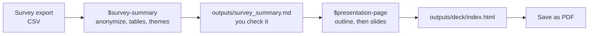

# 98: Present your work

Turn a survey into a short, good-looking presentation in about 40 minutes,
using two of the example skills. No programming needed.

You will use a **synthetic** (made-up) survey of visitors to Beppu, shaped
exactly like a Google Forms export, including the email addresses real
exports contain. Later you can run the same steps on your own survey.



## Before you start

- Get the workshop files: download the ZIP, or let Codex download it
  ([Get the workshop files](../#get-the-workshop-files)).
- In the ChatGPT app, open the folder **`98-present-your-work`** (inside
  `codex-seminar-main`) and choose **Codex**.
- Nothing to install: this folder already contains the two skills it uses,
  in a hidden folder `.agents/skills`. Check with:
  `Which skills can you use right now? List their names.`
  You should see `survey-summary` and `presentation-page` (there may be many
  others).
- Do the [Python check](../00-install/#get-ready-for-the-data-tracks-python)
  once. If Codex asks permission to use the internet to install pandas,
  approve it.

## Step 1: Check the brief (2 minutes)

```text
Read AGENTS.md and summarize the project, the data and the rules in five bullet points. Do not change any files.
```

**Check:** Codex should mention that the data is synthetic and that names and
emails must be removed.

## Step 2: Summarize the survey (10 minutes)

```text
$survey-summary Summarize this survey for my presentation. Compare domestic and international visitors.
```

Codex may ask some of these questions, or it may use `AGENTS.md` and go
straight on. Either is fine. Suggested answers:

| If Codex asks... | You can answer... |
| --- | --- |
| Remove the duplicate submission? | Yes, keep one copy. |
| It says it **kept** a duplicate without asking. | `Remove the duplicate, keep one copy, and run the summary again.` |
| Which groups to compare? | Domestic and international, as defined in AGENTS.md. |
| How to treat skipped questions? | Leave them out of that question's results and report how many were skipped. |
| It shows a plan and waits. | Read it. If it looks right, reply `OK`. |

> Python or pandas missing? See [Get ready for the data tracks](../00-install/#get-ready-for-the-data-tracks-python).

**Check:** the summary should say **120** responses (60 domestic, 60
international). If it says 121, the duplicate is still in: use the reply
above.

## Step 3: Check it yourself (5 minutes)

1. Open `outputs/responses_anonymous.csv`. **Are the email and name
   columns gone?** If not, stop and tell Codex. (The file may still contain
   the duplicate row with a note in an extra column. That is fine.)
2. Open `data/beppu_visitor_survey_SYNTHETIC.csv` in Excel or Google
   Sheets ([how](../help/computer-basics.md#open-a-csv-file-in-a-spreadsheet)).
   Use the formulas in [computer basics](../help/computer-basics.md#count-rows-without-filters-use-a-formula)
   to count the domestic answers, and those rating "Information available
   in my language" 4 or 5. Does the share match Codex's number?
3. Read the quotes in `outputs/survey_summary.md`. Are they exact answers
   from the data?
4. Read the themes. Each theme lists the answers in it. Does each answer
   fit its theme? If one does not, tell Codex, for example:
   `"Toriten and the local seafood" is about food. Move it and update the counts.`

## Step 4: Make the slides (10 minutes)

Start a **New chat** (it uses less of your allowance), then paste:

```text
$presentation-page Make a 7-minute deck from outputs/survey_summary.md for my seminar. Use the field theme.
```

Codex first shows an **outline**: a list of slides, each with a title that
states the takeaway. Read it. Is the most important finding (the biggest
difference between the two groups) in the first two slides? Change anything
you would not say yourself, then reply `OK`.

## Step 5: Open and check the deck (5 minutes)

1. Double-click `outputs/deck/index.html`. It opens in your browser. Use
   the arrow keys; press **F** for full screen.
2. Ask Codex to check it against the design rules:

```text
Check outputs/deck/index.html against the checklist in .agents/skills/presentation-page/references/design-guide.md. For each item, say done or not done, then fix at most the three most important problems.
```

Codex can check the design rules. Checking the numbers by hand stays your
job (Step 3).

## Step 6: Save it as a PDF (2 minutes)

Open the deck in **Chrome** or **Edge**, then **Print** (`Ctrl P` or
`⌘ P`):

- Destination: **Save as PDF**
- Click **More settings**
- Margins: **None**
- Options: tick **Background graphics**

You get one slide per page, which works on any computer and on your course website.

## Step 7: Make it yours

Start a **New chat** for these small changes; it uses much less.

- Make the AI-use note on the last slide true for you:
  `On the last slide of outputs/deck/index.html, change the AI-use note to: "[your sentence]". Change nothing else.`
- Try another theme without rebuilding: `In outputs/deck/index.html, change only data-theme on the html tag to editorial.`
- Use your own survey: first install the skills for your own projects
  ([04, Part A](../04-make-a-skill/#part-a-install-the-example-skills-5-minutes)),
  then put the export in a new folder with an `AGENTS.md` like this one and
  repeat steps 2-6.

## Finished?

Compare your numbers with [the answer key](../answer-keys/98-present-your-work.md).
