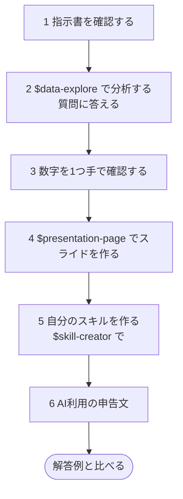

[English](README.md) · **日本語**

# 99：私の例をなぞる

自分のプロジェクトがない人向けのコースです。私の卒業論文では、日本のごみ焼却施設を分析しました。その小さな版を、同じ公開データと下のプロンプトを使ってくり返します。ステップ02〜04のすべての考え方を練習できます。指示書・まず計画・手での確認・発表・スキル作りです。

時間：約40分。プログラミングは必要ありません。
[見本のスキル](../skills/README.ja.md)を2つ使い、自分のスキルを1つ作ります。

## 問い

日本でよく引用される統計では、市町村のごみ焼却施設のうち発電しているのは約**10施設中4施設**だけです（環境省の FY2024（2024年度）のまとめ：焼却施設991施設のうち415施設、41.9%。練習用データはレコードの数え方が少し違うので、あなたの結果は41.1%になります）。少なく聞こえます。でも、小さな施設も巨大な施設も、同じ「1つ」として数えられます。実際には、**ごみ**の大部分は発電している施設で燃やされているのでしょうか？

## 6つのステップの全体像



## フォルダはこうなります

```
99-follow-my-example/
├── AGENTS.md                  指示書（最初からある）
├── data/
│   └── incinerators_fy2005_fy2024.csv   データ（最初からある。絶対に変えない）
├── scripts/                   ステップ2：Codex が書いて実行するコード
├── outputs/
│   ├── results.csv            ステップ2：3つの割合
│   ├── *.png                  ステップ2：グラフ
│   ├── findings.md            ステップ2：分析結果メモ
│   └── deck/index.html        ステップ4：あなたのスライド
└── .agents/skills/            スキルが入った隠しフォルダ
    ├── data-explore/          最初からある
    ├── presentation-page/     最初からある
    └── coverage-check/        ステップ5：あなたが作るスキル
```

## 始める前に

1. ワークショップのファイルを手に入れます。ZIP をダウンロードするか、Codex にダウンロードしてもらいます
   （[ワークショップのファイルを手に入れる](../README.ja.md#get-the-workshop-files)）。
2. ChatGPT デスクトップアプリで、フォルダ **`99-follow-my-example`**
   （`codex-seminar-main` の中）を開き、**Codex** を選びます。
3. このフォルダには、`AGENTS.md`（プロジェクトの指示書）・データ・使う2つのスキル（隠しフォルダ `.agents/skills` の中）がすでに入っています。インストールするものはありません。
4. [Python の確認](../00-install/README.ja.md#get-ready-for-the-data-tracks-python)
   を一度行っておきます。pandas をインストールするためにインターネットを使う許可を Codex に求められたら、許可してください。

## ステップ1：Codex が指示書を読んだか確認する（2分）

```text
AGENTS.md を読んで、プロジェクト・データ・ルールを5つの箇条書きでまとめてください。ファイルは何も変えないでください。
```

## ステップ2：`$data-explore` で分析する（10分）

```text
$data-explore 「発電している焼却施設は約10施設中4施設だけ」という数字が、発電している施設で燃やされているごみの量を実際より小さく見せていないかを知りたいです。FY2005 と FY2024 について、次を計算してください：(1) 発電設備があるレコードの割合、(2) 発電しているレコードで燃やされたごみの量の割合、(3) 発電設備があるレコードの処理能力（設計値）の割合。定義は AGENTS.md のものを使ってください。また、発電設備容量（power_capacity_kw）が空欄のレコードを0として数えずに除いた場合、FY2024 の発電設備がある割合はいくつになるかも教えてください。そして data/README.md を使って、2つのやり方でなぜこれほど数字が違うのかを1文で説明してください。
```

このスキルを使うと、Codex はデータの説明をし、答えを変えてしまう判断を確認します。Codex は次のような質問をすることがあります。`AGENTS.md` を使って、質問せずにそのまま結果を出すこともあります。どちらでも問題ありません。答え方の例：

| Codex がこう聞いてきたら… | こう答えられます… |
| --- | --- |
| 空欄はどう扱いますか？ | AGENTS.md のとおり、0として扱ってください。空欄を除いた場合の FY2024 の割合も教えてください。 |
| 消すべき重複はありますか？ | すべての行を残してください。1行は、ある年の1つの施設です。同じ施設が2005年に1回、2024年に1回出てくることがあります。 |
| 「発電設備がある」とは何を指しますか？ | AGENTS.md のとおり、power_capacity_kw が0より大きいことです。 |
| 計画を見せて、返事を待っている。 | 読んでください。よさそうなら `OK` と返信します。 |

> Python や pandas がない場合は、[データを使うコースの準備](../00-install/README.ja.md#get-ready-for-the-data-tracks-python) を見てください。

**確認：** 空欄を除いた場合の FY2024 の割合を見てください。空欄の2つの扱い方で、数字は大きく変わります。どちらが正しいでしょうか。それはなぜでしょうか。

## ステップ3：数字を1つ自分で確認する（5分）

Codex を使わずに、**手で**行います：

1. `data/incinerators_fy2005_fy2024.csv` を Excel か Google スプレッドシートで開きます
   （[開き方](../help/computer-basics.ja.md#open-a-csv-file-in-a-spreadsheet)）。
2. [パソコンの基本](../help/computer-basics.ja.md#count-rows-without-filters-use-a-formula)
   にある数式を使って、FY2024 のレコードの数と、そのうち `power_capacity_kw`
   が0より大きいレコードの数を数えます。割り算をします。
3. `outputs/findings.md` にある **FY2024 の発電設備があるレコードの割合**と合っていますか？

次に、Codex 自身にも確認させます：

```text
outputs/findings.md の数字が間違っている可能性を3つ挙げて、いちばんありそうなものを試し、結果が変わるかどうかを教えてください。
```

## ステップ4：`$presentation-page` でスライドを作る（10分）

**New chat**（新しいチャット）を始めて（利用枠の消費が少なくなります）、次を貼り付けます：

```text
$presentation-page outputs/findings.md から、ゼミの授業用の5分のスライドを作ってください。editorial テーマを使ってください。スライドは日本語で作ってください。
```

Codex はまず**構成案**を見せます。次の点を確認します：

- どのスライドのタイトルも要点を言い切っていて、どの数字も
  `findings.md` から来ていること。
- 空欄についてのスライドで、正しい数字は **41.1%** であることと、その理由が書かれていること。
- 「発電設備がある」（41.1%）と「発電している」（40.4%）が入れ替わっていないこと。

それから `OK` と返信します。

そのあと：

1. `outputs/deck/index.html` をダブルクリックして開きます。矢印キーで移動し、
   **F** で全画面になります。
2. PDF を保存するには、**Chrome** か **Edge** から印刷します。送信先 **PDF に保存**、**詳細設定** をクリック、余白 **なし**、**背景のグラフィック** にチェック。

## ステップ5：自分のスキルを作る（10分）

今行った確認は、どの年度・どの都道府県でもくり返せます。これをスキルとして保存しましょう。**New chat** を始めて、次を貼り付けます：

```text
$skill-creator このプロジェクト用に coverage-check というスキルを作ってください。年度（と、必要なら都道府県）を指定すると、AGENTS.md の定義を使って data/incinerators_fy2005_fy2024.csv から3つのカバー率を計算し、結果を outputs/ に保存し、ユーザーが手で確認すべき数字を1つと、その確認方法を伝えるスキルです。このスキルは、私が発電設備のカバー率やカバー率チェックについて聞いたときに使われるようにし、ほかの分析には使われないようにしてください。このスキルは、データファイルを絶対に変えてはいけません。また、施設が建てられた理由や閉じられた理由を絶対に言い切ってはいけません。スキルは指示だけにして、中にスクリプトは入れないでください。このプロジェクトの .agents/skills フォルダに保存してください。
```

`$skill-creator` が質問してきたら：

| Codex がこう聞いてきたら… | こう答えられます… |
| --- | --- |
| いつ使われるようにしますか？ | 発電設備のカバー率やカバー率チェックについて私が聞いたときです。 |
| 指示だけですか、スクリプトも入れますか？ | 指示だけです。 |
| どこに保存しますか？ | このプロジェクトの `.agents/skills` フォルダです。 |
| 絶対にしてはいけないことはありますか？ | データファイルを変えないこと。施設が建てられた理由や閉じられた理由を言い切らないこと。 |

Codex は、保護されたフォルダ `.agents` に書き込む**許可**を求めます。許可してください。

**新しいチャット**で試します：

```text
$coverage-check FY2024 の東京都（Tokyo）だけについて、カバー率チェックを実行してください。
```

次に、中身を見てみます：

```text
coverage-check 用に作った SKILL.md を見せて、それぞれの部分をわかりやすい日本語で説明してください。
```

## ステップ6：AI利用の申告文を書く（2分）

```text
このフォルダのファイル（AGENTS.md、outputs/、coverage-check スキル）を見てください。あなたがしたことと私がしたことを述べる、2文のAI利用の申告文を下書きしてください。私が自分で確認したのは次の2つです：FY2024 の発電設備がある割合（1,014件中417件、41.1%）をスプレッドシートで手で確認したこと、そしてあなたがスライドを作る前に構成案を確認したこと。あなたの分も私の分も、大げさに書かないでください。
```

確認したことの一覧を、自分にとって本当の内容に書き換えてください。そのあと、ほかに間違っているところも直します。

## 追加課題（任意）：同じ施設を追いかける

FY2005 から FY2024 のあいだに、割合は22%から41%に上がりました。私の卒業論文では、この上昇の主な理由は、古い施設が発電設備を追加したことではなく、どの施設が存在するかが変わったことだとわかりました。確かめてみましょう：

```text
facility_id を使って、FY2005 と FY2024 の両方に出てくる施設を見つけてください。その施設だけで見ると、それぞれの年に発電設備があった割合はいくつですか？すべてのレコードでの割合と比べて、その違いをわかりやすい日本語で説明してください。
```

## 終わったら

自分の数字を[解答例](../answer-keys/99-follow-my-example.ja.md)と比べてください。
違っていたら、なぜ違うのかを Codex に聞きます。いちばん多い原因は、定義の違いか、空欄の扱い方の違いです。
