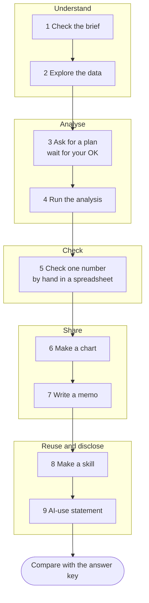

# 99: Follow my example

No project of your own? Repeat a small version of the analysis from my
graduation thesis on Japan's waste incinerators, using the same public data
and the prompts below. You will practise every idea in steps 02-04: a brief,
plan first, small steps, checking by hand, writing it up, and making a
skill.

Time: 30-45 minutes. No programming needed.

## The question

Japan's headline statistic says only about **4 in 10** municipal
incinerators generate electricity. That sounds low. But a small plant and a
huge plant each count as one. Is most of the **waste** actually burned at
plants that generate?

## The nine steps at a glance



## What your folder will look like

```
99-follow-my-example/
├── AGENTS.md                         the brief (given)
├── data/
│   └── incinerators_fy2005_fy2024.csv   the data (given, never changed)
├── scripts/
│   └── coverage.py                   step 4: Codex writes it
├── outputs/
│   ├── coverage.csv                  step 4: the three percentages
│   ├── coverage.png                  step 6: the chart
│   └── memo.md                       step 7: the memo
└── .agents/skills/coverage-check/
    └── SKILL.md                      step 8: your skill
```

## Set up (5 minutes)

1. On this repository's GitHub page, choose **Code → Download ZIP** and
   unzip it.
2. In the ChatGPT desktop app, open the folder **`99-follow-my-example`**
   (not the whole repository) and switch to **Codex**.
3. The folder already contains:
   - `AGENTS.md`: the project brief. Read it; Codex reads it before every task.
   - `data/incinerators_fy2005_fy2024.csv`: the data.

Do not open `answer-key/` until you have your own results.

## Step 1: Check that Codex read the brief

```text
Read AGENTS.md and summarize the project, the data and the rules in five bullet points. Do not change any files.
```

## Step 2: Explore the data

```text
Look at data/incinerators_fy2005_fy2024.csv. Tell me how many rows there are for each fiscal year, what each column means, and how many values are missing in each column. Do not change any files.
```

✅ Check: you should see two fiscal years with different numbers of rows.

## Step 3: Ask for a plan first

```text
I want to know whether "only about 4 in 10 incinerators generate electricity" understates how much waste is covered. Before writing any code, give me a short plan: three percentages you would calculate for each fiscal year, the exact formula for each using the column names, and two things that could make the numbers wrong. Wait for my OK.
```

Read the plan. The three percentages should be:

1. Share of **records** with a generator.
2. Share of **waste burned** (throughput) at records that **generate**.
3. Share of **design capacity** at records with a generator.

If the plan is different, tell Codex what to change.

## Step 4: Run the analysis

```text
OK. Write a short Python script, scripts/coverage.py, that calculates the three percentages for FY2005 and FY2024, saves them to outputs/coverage.csv, and prints a small table. Run it and show me the table. Explain each line of the script in one sentence.
```

> If Codex says Python or a package is missing, ask:
> `What do I need to install, and how? Do not install anything yourself.`

## Step 5: Check one number yourself

Do this **by hand**, without Codex:

1. Open `data/incinerators_fy2005_fy2024.csv` in Excel or Google Sheets.
2. Filter `fiscal_year` to **2024**. Count the rows.
3. Filter `power_capacity_kw` to values **greater than 0**. Count again.
4. Divide. Does it match Codex's first percentage?

Then ask Codex to check itself:

```text
List three ways the percentages in outputs/coverage.csv could be wrong (for example how blanks were treated or how "generate" was defined). Test each one and tell me whether the results change.
```

## Step 6: Make a chart

```text
Make one clear bar chart comparing the three percentages for FY2005 and FY2024, saved as outputs/coverage.png. Use plain labels a non-specialist can read. Then explain in two sentences what the chart shows.
```

## Step 7: Write a one-page memo

```text
Write outputs/memo.md: a one-page memo for a policy reader. Include the three FY2024 percentages, how they changed since FY2005, what they mean in plain English, the chart, and two limitations of the data. Do not claim anything the data cannot show, such as why plants were built or closed.
```

Read the memo. Change anything you would not say yourself.

## Step 8: Turn it into a skill

You have just done a workflow you could repeat for any year or region.
Save it as a skill (see [04: Make a skill](../04-make-a-skill/)):

```text
$skill-creator Create a skill called coverage-check for this project. Given a fiscal year (and optionally a prefecture), it should calculate the three coverage percentages from data/incinerators_fy2005_fy2024.csv using the definitions in AGENTS.md, save the results to outputs/, and report one number the user should check by hand and how. It should trigger when I ask about generator coverage or the coverage check, and not for other analyses. Keep it instruction-only, with no scripts.
```

Test it in a **new chat**:

```text
$coverage-check Run the coverage check for FY2024 for Tokyo only.
```

## Step 9: Write your AI-use statement

```text
Look at what we did in this folder. Draft a two-sentence AI-use statement saying what you did and what I checked myself. Do not exaggerate either part.
```

## Stretch: follow the same plants

My thesis found that the national rise mostly came from the list of plants
changing, not from old plants adding generators. Check it:

```text
Using facility_id, find the plants that appear in both FY2005 and FY2024. For those plants only, what share had a generator in each year? Compare it with the share among all records, and explain the difference in plain English.
```

## Finished?

Compare your numbers with [answer-key/ANSWERS.md](answer-key/ANSWERS.md).
If yours differ, ask Codex why: the most common cause is a different
definition or a different treatment of blanks.
