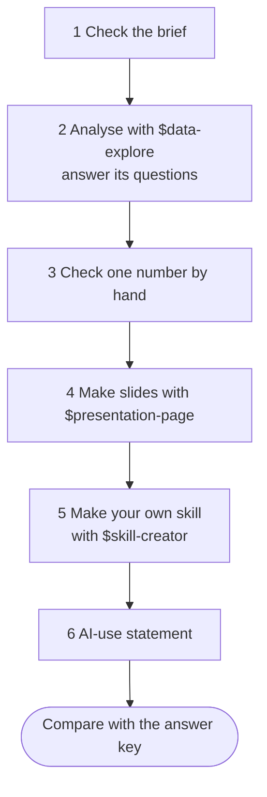

**English** · [日本語](README.ja.md)

# 99: Follow my example

No project of your own? Repeat a small version of the analysis from my
graduation thesis on Japan's waste incinerators, using the same public data
and the prompts below. You will practise every idea in steps 02-04: a brief,
plan first, checking by hand, presenting, and making a skill.

Time: about 40 minutes. No programming needed. You will use two of the
[example skills](../skills/) and make one of your own.

## The question

Japan's headline statistic says only about **4 in 10** municipal
incinerators generate electricity (the Ministry of the Environment's FY2024
summary: 415 of 991 incineration facilities, 41.9%; our practice data
counts records a little differently, so you will get 41.1%). That sounds low. But a small plant and a
huge plant each count as one. Is most of the **waste** actually burned at
plants that generate?

## The six steps at a glance



## What your folder will look like

```
99-follow-my-example/
├── AGENTS.md                  the brief (given)
├── data/
│   └── incinerators_fy2005_fy2024.csv   the data (given, never changed)
├── scripts/                   step 2: code Codex writes and runs
├── outputs/
│   ├── results.csv            step 2: the three percentages
│   ├── *.png                  step 2: charts
│   ├── findings.md            step 2: the findings memo
│   └── deck/index.html        step 4: your slides
└── .agents/skills/            hidden folder of skills
    ├── data-explore/          given
    ├── presentation-page/     given
    └── coverage-check/        step 5: the skill you make
```

## Before you start

1. Get the workshop files: download the ZIP, or let Codex download it
   ([Get the workshop files](../#get-the-workshop-files)).
2. In the ChatGPT desktop app, open the folder **`99-follow-my-example`**
   (inside `codex-seminar-main`) and choose **Codex**.
3. The folder already contains `AGENTS.md` (the project brief), the data,
   and the two skills it uses (in a hidden folder `.agents/skills`), so
   there is nothing to install.
4. Do the [Python check](../00-install/#get-ready-for-the-data-tracks-python)
   once. If Codex asks permission to use the internet to install pandas,
   approve it.

## Step 1: Check that Codex read the brief (2 minutes)

```text
Read AGENTS.md and summarize the project, the data and the rules in five bullet points. Do not change any files.
```

## Step 2: Analyse with `$data-explore` (10 minutes)

```text
$data-explore I want to know whether "only about 4 in 10 incinerators generate electricity" understates how much waste is covered. For FY2005 and FY2024, calculate: (1) the share of records with a generator, (2) the share of waste burned at records that generate, and (3) the share of design capacity at records with a generator. Use the definitions in AGENTS.md. Also tell me the FY2024 share with a generator if blank power values were dropped instead of counted as zero, and, using data/README.md, explain in one sentence why the two ways give such different numbers.
```

The skill makes Codex describe the data and check the decisions that
change the answer. Codex may ask you these questions, or it may use
`AGENTS.md` and go straight to the results. Either is fine. Suggested
answers:

| If Codex asks... | You can answer... |
| --- | --- |
| How should blanks be treated? | As zero, as AGENTS.md says. Also tell me what the FY2024 share would be if blanks were dropped instead. |
| Are there duplicates to remove? | Keep all rows: each row is one plant in one year. A plant can appear once in 2005 and once in 2024. |
| What counts as "has a generator"? | power_capacity_kw above zero, as AGENTS.md says. |
| It shows a plan and waits. | Read it. If it looks right, reply `OK`. |

> Python or pandas missing? See [Get ready for the data tracks](../00-install/#get-ready-for-the-data-tracks-python).

**Check:** Look at the FY2024 share with blanks dropped. The two ways of treating
blanks give very different numbers. Which one is right, and why?

## Step 3: Check one number yourself (5 minutes)

Do this **by hand**, without Codex:

1. Open `data/incinerators_fy2005_fy2024.csv` in Excel or Google Sheets
   ([how](../help/computer-basics.md#open-a-csv-file-in-a-spreadsheet)).
2. Use the formulas in [computer basics](../help/computer-basics.md#count-rows-without-filters-use-a-formula)
   to count FY2024 records, and FY2024 records with `power_capacity_kw`
   above zero. Divide.
3. Does it match the **FY2024 share of records with a generator** in
   `outputs/findings.md`?

Then ask Codex to check itself:

```text
List three ways the numbers in outputs/findings.md could be wrong, test the most likely one, and tell me whether the result changes.
```

## Step 4: Make slides with `$presentation-page` (10 minutes)

Start a **New chat** (it uses less of your allowance), then paste:

```text
$presentation-page Make a 5-minute deck from outputs/findings.md for a seminar class. Use the editorial theme.
```

Codex first shows an **outline**. Check that:

- every slide title states a takeaway, and every number comes from
  `findings.md`;
- the slide about blanks says **41.1%** is the right number, and why;
- "has a generator" (41.1%) and "generates" (40.4%) are not swapped.

Then reply `OK`.

Then:

1. Double-click `outputs/deck/index.html` to open it. Arrow keys move;
   **F** is full screen.
2. To save a PDF, print from **Chrome** or **Edge**: Destination **Save as
   PDF**, click **More settings**, Margins **None**, tick **Background
   graphics**.

## Step 5: Make your own skill (10 minutes)

You just did a check you could repeat for any year or prefecture. Save it
as a skill. Start a **New chat**, then paste:

```text
$skill-creator Create a skill called coverage-check for this project. Given a fiscal year (and optionally a prefecture), it should calculate the three coverage percentages from data/incinerators_fy2005_fy2024.csv using the definitions in AGENTS.md, save the results to outputs/, and report one number the user should check by hand and how. It should be used when I ask about generator coverage or the coverage check, and not for other analyses. It must never change the data file and never claim why plants were built or closed. Keep the skill instruction-only, with no scripts inside it. Save it in this project's .agents/skills folder.
```

If the skill creator asks questions:

| If Codex asks... | You can answer... |
| --- | --- |
| When should it trigger? | When I ask about generator coverage or the coverage check. |
| Instructions only, or scripts too? | Instructions only. |
| Where should it be saved? | In this project's `.agents/skills` folder. |
| Anything it must never do? | Never change the data file. Never claim why plants were built or closed. |

Codex will ask for **permission** to write in `.agents`, a protected
folder. Approve it.

Test it in a **new chat**:

```text
$coverage-check Run the coverage check for FY2024 for Tokyo only.
```

Then look inside it:

```text
Show me the SKILL.md you made for coverage-check and explain each part in plain English.
```

## Step 6: Write your AI-use statement (2 minutes)

```text
Look at the files in this folder (AGENTS.md, outputs/ and the coverage-check skill). Draft a two-sentence AI-use statement saying what you did and what I did. I checked these myself: the FY2024 share with a generator (417 of 1,014, 41.1%) by hand in a spreadsheet, and the slide outline before you built it. Do not exaggerate either part.
```

Change the list of what you checked so it is true for you, then correct
anything else that is wrong.

## Extra task (optional): follow the same plants

Between FY2005 and FY2024 the share rose from 22% to 41%. My thesis found
this came mostly from changes in which plants exist, not from old plants
adding generators. Check it:

```text
Using facility_id, find the plants that appear in both FY2005 and FY2024. For those plants only, what share had a generator in each year? Compare it with the share among all records, and explain the difference in plain English.
```

## Finished?

Compare your numbers with [the answer key](../answer-keys/99-follow-my-example.md).
If yours differ, ask Codex why: the most common cause is a different
definition or a different treatment of blanks.
