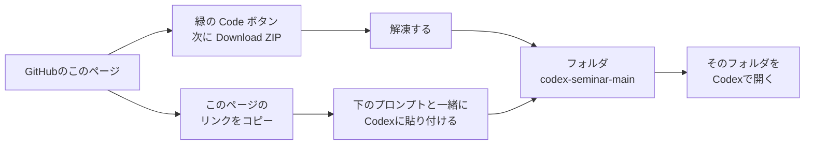
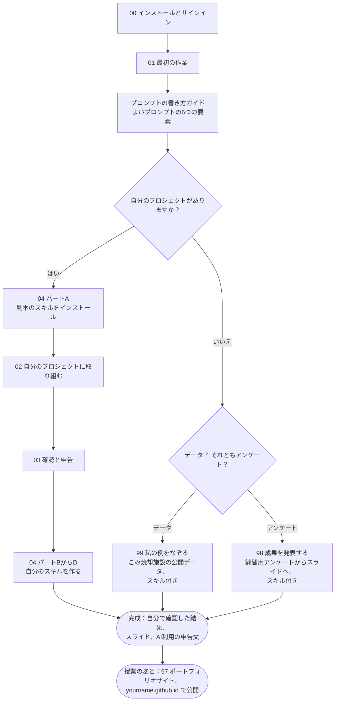
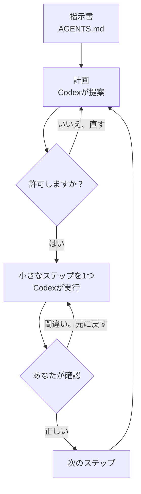

[English](README.md) · **日本語**

# 研究に使うCodex：ゼミ・ワークショップ

OpenAIのコーディング用エージェント「Codex」を使って、自分のノートパソコンの
フォルダで実際の研究作業をします。データを読み、分析コードを書いて実行し、
グラフやメモの下書きを作ります。判断はすべてあなたがします。結果の確認も
あなたがします。

ゼミの発表者：Pann Phetra（立命館アジア太平洋大学 サステイナビリティ観光学部）

**スライド：** [PDFで見る](slides/codex-for-research-ja.pdf) · [Web版を開く](https://pann13223029.github.io/codex-seminar/slides/ja/) · [すべての見方](slides/README.ja.md)（スマートフォンではPDFを使ってください）

## 必要なもの

1. **ChatGPTアカウント**。**無料プラン（Free）で十分です**。デスクトップ
   アプリのCodexと **GPT-6 Luna** モデルが使えます。ただし利用枠には上限が
   あります。まだ使えないアカウントもあります
   （[Codexの料金](https://learn.chatgpt.com/docs/pricing)、
   [モデル](https://learn.chatgpt.com/docs/models)）。このガイドの内容は
   すべてLunaでできます。
2. **macOS・Windows・Linux** のノートパソコンと、そこにインストールした
   **ChatGPTデスクトップアプリ**（[公式クイックスタート](https://learn.chatgpt.com/docs/quickstart)）。
3. 必須ではありませんが、おすすめ：**Git**。アプリはGitを使って、Codexが
   変えた内容を表示したり、変更を元に戻したりします。
4. フォルダに入った自分のゼミのプロジェクト。何もなくてもかまいません。
   [コース99「私の例をなぞる」](99-follow-my-example/README.ja.md)に、
   データとコピー＆ペースト用のプロンプトがあります。

> **無料プランの場合：** 利用枠には上限があります。1つのチャットでは1つの
> 作業だけにしてください。簡単な作業には、推論の強さ **Light**（軽め）を
> 使います。長いプロンプトは、まず無料のチャットボットで下書きします。
> [利用枠を長持ちさせる](prompt-guide/README.ja.md#make-your-usage-last)を見てください。

> **プライバシー：** 個人データ、インタビューの書き起こし、共有を許されて
> いない未公開データ、パスワードを、Codexで開くフォルダに入れないで
> ください。ファイルを外部のサービスに送るのと同じだと考えてください。

> **学術上の誠実さ：** AIの助けを申告しないと、大学の規則（APUの規則も
> 含みます）で盗用とみなされることがあります。授業のルールを確認して
> ください。論文や課題でAIの助けを使ったら、そのことを書いてください。
> 書き方はステップ03で説明します。

> **基本的な操作でつまずいたら**（解凍、隠しフォルダ、CSVを開く、行を
> 数える）：[パソコンの基本](help/computer-basics.ja.md)を見てください。

> **Codexが許可を求めてきたら：** Codexは、あなたが開いたフォルダの中で
> 作業します。次のときは、先に許可を求めます。保護されたフォルダ（`.git`
> や `.agents`）に書き込むとき、フォルダの外に書き込むとき、インターネット
> を使うとき（たとえばpandasをインストールするとき）です。Codexが何を
> したいのかを読んでください。頼んだ内容と合っていれば、許可します。
> Codexが何かを**できない**と言い、許可を求めなかったときは、こう返信
> します：`許可を求めてから、もう一度試してください。`

<a id="get-the-workshop-files"></a>
## ワークショップのファイルを手に入れる

練習コースと見本のスキルを使うには、このガイドのコピーが自分のパソコンに
必要です。次のどちらかの方法を選んでください。



**方法1：ZIPをダウンロードする。** Codexは要りません。GitHubのこの
リポジトリのトップページ（https://github.com/Pann13223029/codex-seminar）の
上にある、緑の **Code** ボタンをクリックし、**Download ZIP**（ZIPを
ダウンロード）を選びます。ファイルを解凍します
（[解凍のしかた](help/computer-basics.ja.md#unzip-the-downloaded-repository)）。
`codex-seminar-main` というフォルダができます。

**方法2：Codexにダウンロードしてもらう。** 先に[ステップ00](00-install/README.ja.md)を
済ませます。次に、新しい空のフォルダを作ります（たとえば、ドキュメント
（書類）フォルダの中に `workshop`）。そのフォルダをCodexで開き、次を
貼り付けます：

```text
https://github.com/Pann13223029/codex-seminar にあるワークショップのガイドを、ここに codex-seminar-main という新しいフォルダを作ってダウンロードしてください。Gitがインストールされていれば、Gitを使ってください。インストールされていなければ、GitHubからZIPファイルをダウンロードして解凍してください。そのあと README.ja.md（日本語版）を読んで、最初に何をすればよいかを短い5行で教えてください。ファイルは何も変更しないでください。
```

Codexが、インターネットを使う許可を求めることがあります。何をしたいの
かを読んでから、許可してください。

**次に、Codexに案内してもらう。** Codexで `codex-seminar-main` フォルダを
開き、**New chat**（新しいチャット）を始めて、次を貼り付けます：

```text
このフォルダの README.ja.md（日本語版）を読んでください。そのあと、ワークショップを1ステップずつ、わかりやすい日本語で案内してください。各ステップのページ（各フォルダの README.ja.md）はあなた自身が読んで、私に説明してください。最初にやるべきことから始めてください。各ステップのあと、私が「できました」と言うまで待ってください。アプリで別のフォルダを開くように言うのは、ステップにそのフォルダで作業すると書いてあるときだけにしてください。そのときは、そこで新しいチャットが始まることを先に伝えてください。このチャットにはあとで戻れます。答えはワークショップのファイルをもとにして、Webで検索しないでください。answer-keys フォルダは開かないでください。私が頼まない限り、ファイルは何も変更しないでください。
```

どのステップも、このページで自分で読めます。Codexは、説明したり、
つまずいたときに助けたりするためにいます。

## ワークショップの進み方



## Codexとの作業のしかた

どの作業も、同じ流れをくり返します。2つの判断の場面では、あなたが
決めます。



## ワークショップを進める

| 開く | やること |
| --- | --- |
| [00：インストールとサインイン](00-install/README.ja.md) | ChatGPTデスクトップアプリをインストールし、サインインして、Codexを開きます。 |
| [01：最初の作業](01-first-task/README.ja.md) | フォルダを開き、Codexに中身を説明してもらいます。変更を確認して、元に戻します。 |
| [プロンプトの書き方ガイド](prompt-guide/README.ja.md) | よいプロンプトの6つの要素、書き直す前と後の例、無料のチャットボットで使えるプロンプト作成役。 |
| [02：自分のプロジェクトに取り組む](02-your-project/README.ja.md) | 短い指示書を書き、まず計画を頼み、小さなステップで進めます。 |
| [03：確認と申告](03-verify-and-disclose/README.ja.md) | 結果を自分で確認し、AI利用の申告文を書きます。 |
| [04：スキルを一歩ずつ](04-make-a-skill/README.ja.md) | 見本のスキルをインストールして1つ使い、自分のスキルを作ります。すべてコピー＆ペーストのプロンプトでできます。 |
| [98：成果を発表する](98-present-your-work/README.ja.md) | 練習用アンケート → 確認した要約 → スライドとPDF。見本のスキル2つ付き。 |
| [99：私の例をなぞる](99-follow-my-example/README.ja.md) | 私の論文の分析を小さくしたものを、見本のスキルを使ってくり返します。そのあと、自分のスキルを作ります。 |
| [97：ポートフォリオサイトを公開する](97-portfolio-site/README.ja.md) | **授業のあと、就職活動（就活）用：** 履歴書（CV）から1ページのポートフォリオサイトを作り、無料でオンラインに公開します。 |
| [見本のスキル](skills/README.ja.md) | `data-explore`・`survey-summary`・`presentation-page`・`portfolio-page`。すぐにインストールできます。 |

**00 → 01 → プロンプトの書き方ガイド** の順に進みます。そのあと、自分の
プロジェクト（**04 パートA → 02 → 03 → 04 パートBからD**）か、練習コース
の **98**（アンケートからスライドへ）または **99**（データ分析）に進みます。
練習コースには見本のスキルが最初から入っているので、インストールするものは
ありません。授業のあと、**97** で履歴書（CV）からポートフォリオサイトを
作り、オンラインで公開できます。

## ここで使う言葉

- **エージェント：** チャットで答えるだけでなく、あなたのフォルダの中で
  動ける（ファイルを読む・書く、プログラムを実行する）AI。
- **プロンプト：** あなたが入力する指示。
- **指示書（`AGENTS.md`）：** そのフォルダで作業をするたびに、Codexが
  先に読む、決まった指示のファイル。
- **スキル：** 保存して何度も使える作業の手順（`SKILL.md` ファイルが
  入ったフォルダ）。頼めば、Codexがもう一度実行できます。

## アプリの見た目が違うとき

Codexはどんどん変わります。ボタンの見た目がここの説明と違うときは、
リンク先の公式ページに従ってください。
