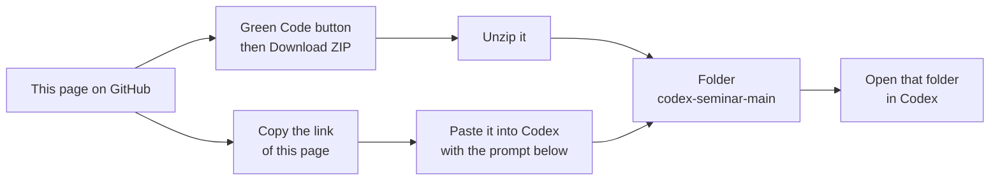
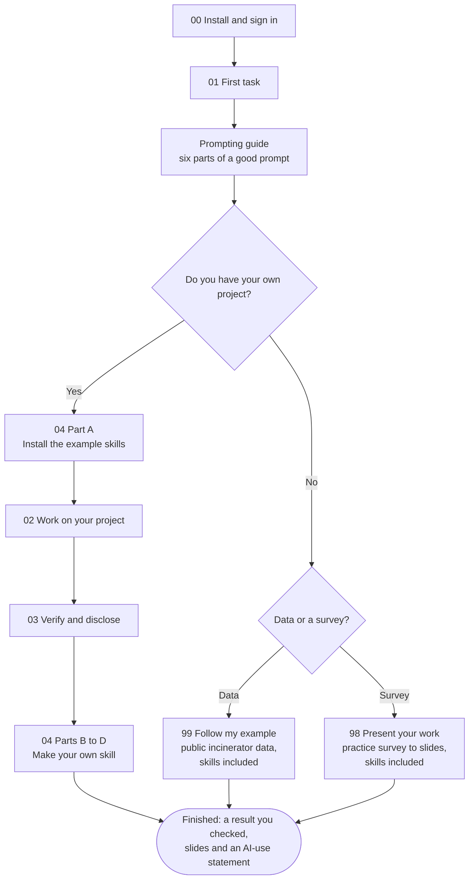
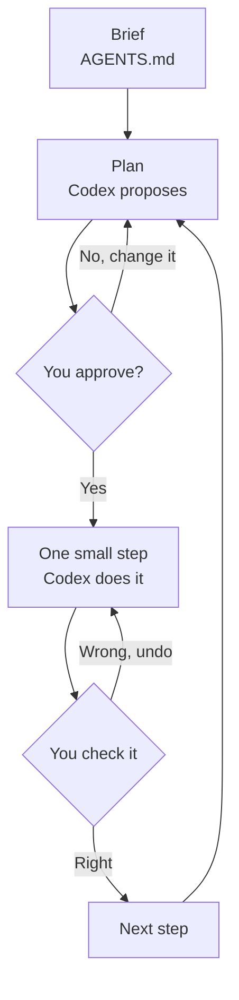

# Codex for Research: a Seminar Workshop

Use Codex, OpenAI's coding agent, to do real research work in a folder on your
own laptop: read data, write and run analysis code, make charts and draft
notes, while you stay in charge of every decision and check the results.

Seminar session by Pann Phetra (College of Sustainability and Tourism,
Ritsumeikan Asia Pacific University).

**Slides:** [view as PDF](slides/codex-for-research.pdf) · [open the web version](https://pann13223029.github.io/codex-seminar/slides/) · [all options](slides/) (on a phone, use the PDF)

## What you need

1. A **ChatGPT account**. The **Free plan is enough**. It includes Codex in
   the desktop app with the **GPT-6 Luna** model, with usage limits. Some
   accounts may not have it yet
   ([Codex pricing](https://learn.chatgpt.com/docs/pricing),
   [models](https://learn.chatgpt.com/docs/models)). Everything in this
   guide works with Luna.
2. A laptop running **macOS, Windows or Linux** with the **ChatGPT desktop
   app** installed ([official quickstart](https://learn.chatgpt.com/docs/quickstart)).
3. Optional but recommended: **Git**. The app uses it to show what Codex
   changed and to undo changes.
4. Either your own seminar project in a folder, or nothing at all: the
   [follow-my-example track](99-follow-my-example/) gives you data and
   copy-and-paste prompts.

> **On the Free plan?** Usage is limited, so keep each chat to one task,
> use the **Light** reasoning setting for quick jobs, and draft long prompts
> in a free chat first. See [make your usage last](prompt-guide/#make-your-usage-last).

> **Privacy:** do not put personal data, interview transcripts, unpublished
> data you are not allowed to share, or passwords into a folder you open with
> Codex. Treat it like sending the files to an outside service.

> **Academic integrity:** undisclosed AI help can count as plagiarism under
> university rules, including APU's. Check your course rules, and if AI helps
> with a thesis or assignment, say so. Step 03 shows how.

> **Stuck on a basic step** (unzipping, hidden folders, opening a CSV,
> counting rows)? See [computer basics](help/computer-basics.md).

> **When Codex asks permission:** Codex works inside the folder you opened.
> It asks first before it writes in a protected folder (`.git` or
> `.agents`), writes outside your folder, or uses the internet (for example
> to install pandas). Read what it wants to do. If it matches what you
> asked for, approve. If Codex says it **cannot** do something and did not
> ask, reply: `Please ask me for permission and try again.`

## Get the workshop files

You need a copy of this guide on your laptop for the practice tracks and
the example skills. Choose one way.



**Way 1: Download the ZIP.** No Codex needed. At the top of this page,
click the green **Code** button, then **Download ZIP**. Unzip the file
([how to unzip](help/computer-basics.md#unzip-the-downloaded-repository)).
You get a folder called `codex-seminar-main`.

**Way 2: Let Codex download it.** Do [step 00](00-install/) first. Then
create a new empty folder, for example `workshop` in your Documents folder,
open it in Codex, and paste:

```text
Download the workshop guide at https://github.com/Pann13223029/codex-seminar into a new folder here called codex-seminar-main. Use Git if it is installed; if it is not, download the ZIP file from GitHub and unzip it. Then read README.md and tell me in five short lines what to do first. Do not change any files.
```

Codex may ask your permission to use the internet. Read what it wants to
do, then approve.

**Then let Codex guide you.** Open the folder `codex-seminar-main` in
Codex, start a **New chat**, and paste:

```text
Read README.md in this folder. Then guide me through the workshop one step at a time, in simple English: read each step page yourself and explain it to me. Start with the first thing I need to do. After each step, wait until I say it is done. Tell me to open a different folder in the app only when a step says to work in it, and warn me that this starts a new chat there; I can come back to this chat later. Answer from the workshop files; do not search the web. Do not open the answer-keys folder. Do not change any files unless I ask.
```

You can still read every step yourself on this page. Codex is there to
explain and to help when you are stuck.

## Your route through the workshop



## How you will work with Codex

Every task follows the same loop. You stay in charge of the two decision
points.



## Follow the workshop

| Open | What you will do |
| --- | --- |
| [00: Install and sign in](00-install/) | Install the ChatGPT desktop app, sign in, open Codex. |
| [01: Your first task](01-first-task/) | Open a folder, ask Codex to explain it, review a change and undo it. |
| [Prompting guide](prompt-guide/) | The six parts of a good prompt, before-and-after examples, and a prompt builder for any free chatbot. |
| [02: Work on your own project](02-your-project/) | Write a short brief, ask for a plan first, then work in small steps. |
| [03: Verify and disclose](03-verify-and-disclose/) | Check the results yourself and write an AI-use statement. |
| [04: Skills, step by step](04-make-a-skill/) | Install the example skills, use one, and make your own, all by copy-and-paste prompts. |
| [98: Present your work](98-present-your-work/) | A practice survey → checked summary → slides and PDF, with two example skills. |
| [99: Follow my example](99-follow-my-example/) | Repeat a small version of my thesis analysis with the example skills, then make your own skill. |
| [Example skills](skills/) | `data-explore`, `survey-summary` and `presentation-page`, ready to install. |

Follow **00 → 01 → Prompting guide**, then either your own project
(**04 Part A → 02 → 03 → 04 Parts B to D**) or a practice track: **98**
(survey to slides) or **99** (data analysis). The practice tracks already
include the example skills, so there is nothing to install.

## Words used here

- **Agent:** an AI that can act in your folder (read files, write files, run
  programs) instead of only answering in a chat.
- **Prompt:** the instruction you type.
- **Brief (`AGENTS.md`):** a file of standing instructions Codex reads before
  every task in that folder.
- **Skill:** a saved, reusable workflow (a folder with a `SKILL.md` file) that
  Codex can run again on request.

## If the app looks different

Codex changes quickly. If a button looks different from the text here,
follow the linked official page.
