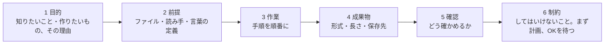
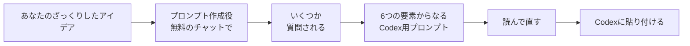

[English](README.md) · **日本語**

# プロンプトの書き方ガイド

よいプロンプトとは、うまい言い回しのことではありません。はっきりした指示のことです。何がほしいのか、何を使うのか、何を返してほしいのか、正しいかどうかをどう確かめるのかを伝えます。Codexは理解できたことしかできません。あいまいなプロンプトからは、あいまいな結果が返ってきます。自信たっぷりの間違った結果が返ってくることもあります。

## よいプロンプトの条件



| 要素 | 自分に聞くこと | 例 |
| --- | --- | --- |
| **1 目的** | 何がほしいのか。何に使うのか。 | 「…7分間のゼミ発表で使うためです」 |
| **2 前提** | どのファイルか。誰が読むのか。自分の言葉は何を意味するのか。 | 「data/survey.csvを使ってください。『海外』は日本以外から来た人のことです。」 |
| **3 作業** | 手順は何か。 | 「名前を削除してから、各評価項目で2つのグループを比べてください。」 |
| **4 成果物** | 何を、どこに返してほしいのか。 | 「outputs/summary.mdに1ページの要約と、棒グラフ2つ。」 |
| **5 確認** | 正しいとどうやってわかるのか。 | 「Excelで手で確認できる数字を1つ教えてください。」 |
| **6 制約** | してはいけないことは何か。どこで止まるべきか。 | 「引用をでっち上げないでください。まず計画を見せて、私のOKを待ってください。」 |

毎回6つすべてを書く必要はありません。ちょっとした質問なら、目的と前提だけで十分です。ファイルや数字が変わる作業では、6つすべてを書きましょう。

## 書き直しの例（前と後）

**よい例**をコピーして、角かっこ [ ] の中を自分の内容に書き換えてください。

### データファイルを分析する

あいまいな例：

```text
データを分析して
```

よい例：

```text
目的：[海外からの観光客]が[国内からの観光客]より[別府]を低く評価しているかを知りたいです。ゼミの発表で使います。
前提：データは[data/survey.csv]です。[海外]とは、[「Where are you visiting from?」の回答が「Japan」で始まらない人]のことです。
作業：まずデータの概要を説明してください。次に、1-5の評価の各質問で2つのグループを比べてください。
成果物：平均と、4または5と答えた人の割合の表をoutputs/results.csvに保存してください。棒グラフを1つ、outputs/に保存してください。
確認：空欄と重複をどう扱ったかを教えてください。スプレッドシートで手で確認できる数字を1つ教えてください。
制約：元のファイルは変更しないでください。まず計画を見せて、私のOKを待ってください。
```

### 自分のメモから文献の表を作る

あいまいな例：

```text
オーバーツーリズムの文献レビューを作って
```

よい例：

```text
目的：[日本のオーバーツーリズム]について、すでに集めた文献の表がほしいです。文献レビューの計画に使います。
前提：私のメモは[notes/]にあります。文献1つにつき1ファイルです。
作業：文献ごとに、著者（年）・調査した場所・データ・方法・主な結果を記録してください。
成果物：outputs/literature.mdに表を作り、年の順に並べてください。あわせて、文献全体を見て気づいた研究の空白を3つ挙げてください。
確認：メモの中で見つからなかったものには[CHECK]と印をつけてください。
制約：私のメモだけを使ってください。メモにない文献・著者・結果は追加しないでください。
```

### 結果からスライドを作る

あいまいな例：

```text
スライドを作って
```

よい例：

```text
目的：[ゼミの授業]で私の分析結果を発表する、[7]分間のスライドがほしいです。
前提：確認済みの分析結果は[outputs/findings.md]にあります。聞き手はテーマを知っていますが、私のデータは知りません。
作業：まず構成案を出してください。1分につき1枚くらいで、各スライドのタイトルは、伝えたいことを言い切る完全な文にしてください。
成果物：私が構成案を許可したら、outputs/deck/にHTMLのスライドを1つ作ってください。オフラインで開けて、PDFとして保存できるものにしてください。
確認：スライドにあるすべての数字と、それがfindings.mdのどこから来たのかを一覧にしてください。
制約：findings.mdにない数字・引用・主張は使わないでください。絵文字やグラデーションは使わないでください。
```

（[見本のスキル](../skills/README.ja.md)を入れていれば、`$presentation-page` がこの作業のほとんどをやってくれます。）

### エラーを直す

あいまいな例：

```text
動かない
```

よい例：

```text
目的：[scripts/coverage.py]を動くようにしたいです。
前提：実行すると、次のエラーが出ます：[エラーメッセージ全文を貼り付け]
作業：エラーの意味をわかりやすい日本語で説明してから、いちばん小さな修正を提案してください。
成果物：修正内容と、原因を説明する1文。
確認：修正のあと、もう一度スクリプトを実行して、動くことを見せてください。
制約：このエラーを直すのに必要なところだけを変更してください。スクリプトを書き直さないでください。
```

## 7つの習慣

1. **1つのプロンプトに1つの作業。** 大きな仕事は、小さなステップの計画に分けます。
2. **ファイル名を書く。** 「私のデータ」ではなく「data/survey.csv」と書きます。
3. **言葉を定義する。** 「海外」「満足」「発電している」などの言葉が、正確に何を意味するのかを書きます。
4. **完成した状態を伝える。** 形式・長さ・保存先を書きます。
5. **まず計画を頼む。** ファイルや数字が変わるときは、いつもそうします。
6. **確かめ方を聞く。** 毎回聞きます。
7. **やり直さずに直してもらう。** 結果が間違っていたら、どこが違うのかを伝えます。例：「グラフは年ではなく、グループを比べてください。」

<a id="make-your-usage-last"></a>
## 利用枠を長持ちさせる

Codexの利用枠は、ほとんどのプランで限られています。いちばん少ないのは無料プラン（Free）です。メッセージを送るたびに、Codexはファイルを読み、考え、コードを実行します。そのため、あいまいな作業は利用枠をたくさん使ってしまいます。

| 習慣 | 利用枠が節約できる理由 |
| --- | --- |
| **1つのチャットに1つの作業。** 新しい仕事ごとに **New chat**（新しいチャット）を始めます。 | チャットが長いと、Codexはそれまでのやりとりを全部読み直します。 |
| **ちょっとした作業は、推論の強さを Light（軽め）にする。** 分析やスライドには High（高め）を使います。 | 推論の強さが高いほど、考える時間が長くなります。 |
| **まず計画、それから許可する。** | 間違った計画を直すのは安く済みます。できあがった作業をやり直すのは高くつきます。 |
| **フォルダを小さく保つ。** 作業に必要なファイルだけを入れます。 | プロジェクトを理解するためにCodexが読む量が減ります。 |
| **プロンプトの下書きは普通のチャットで作る**（次の節）。 | ClaudeとGeminiは、Codexの利用枠を使いません。ChatGPTでは **Work**（作業モード）ではなく、普通の **Chat**（チャット）を使います。WorkはCodexと利用枠を共有しています。 |
| **確認はスプレッドシートで。** もう一度Codexを動かすのではありません。 | 手で確認すれば無料で、学べることも多くなります。 |
| **Plus以上のプランなら、ワークショップの作業は GPT-6 Luna のままで。** | いちばん効率のよいモデルです。Astraモデルや、推論の強さの Max・Ultra は、難しい問題のためにとっておきましょう。 |

## チャットボットにプロンプトを書いてもらう

普通のチャット（Claude、Gemini、または **Work** ではなく **Chat** モードのChatGPT）を使って、ざっくりしたアイデアを、よく整理されたCodex用のプロンプトに変えられます。チャットボットがあなたに質問をして、プロンプトを書きます。あなたはその結果をCodexに貼り付けます。



**役に立つ理由：** いちばん難しいのは、自分が何をしたいのかを考えることです。チャットはそれをじっくり考えるのに向いています。それに、Codexの利用枠を本番の作業のためにとっておけます。

**2つの注意：**

- チャットボットは **あなたのファイルを見ることができません**。そのため、ファイル名や列名を推測してしまうことがあります。下のプロンプト作成役は、推測せずに[角かっこの仮の言葉]を使うように指示しています。そこは自分で埋めるか、Codexに確かめてもらいましょう。
- **個人的なデータをチャットに貼り付けないでください。** データは貼り付けずに、説明だけします（例：「120件の回答があるアンケートで、評価は1から5」）。

### プロンプト作成役

枠の中をすべてコピーして、Claude・Gemini・ChatGPTの新しいチャットに貼り付けてください。そのあと、やりたいことを自分の言葉で説明します。

```text
あなたはプロンプト作成役です。OpenAI Codex向けのプロンプトを1つ書くのを手伝ってください。Codexは、私のパソコンの中の1つのフォルダで作業するAIエージェントで、そこでファイルを読んだり書いたり、コードを実行したりできます。私は大学生で、プログラミングを知らないかもしれません。

進め方：
1. 質問は1回に1つずつ、全部で5つまでにしてください。次のことを理解するために質問してください：私の目的と、それを何に使うのか。Codexがどのファイルを使うべきか。私の大事な言葉が何を意味するのか。何を返してほしいのか、どこに保存してほしいのか。結果を私がどう確認するのか。
2. 私の答えがあいまいなときは、選べる具体的な案を2つか3つ出してください。
3. そのあと、最終的なCodex用プロンプトを、ちょうど次の6つの見出しつきの行で書いてください：目的・前提・作業・成果物・確認・制約。

最終的なプロンプトのルール：
- 400字以内で、わかりやすい日本語で書くこと。
- ファイル名や列名など、わからないものには[角かっこ]を使うこと。決して推測しないこと。
- 制約には必ず次を入れること：元のファイルを変更しない。まず計画を見せて、私のOKを待つ。データ・引用・参考文献を決してでっち上げない。
- 確認には、私が手で確かめられる結果を少なくとも1つ出すよう、Codexに求める内容を入れること。
- プロンプトのあとに、私がまだ埋める必要がある[角かっこ]を一覧にすること。

最初の質問から始めてください。
```

### ほかのチャットボットがない場合：Codexにインタビューしてもらう

```text
作業を始める前に、私にインタビューしてください。質問は1回に1つずつ、最大5つまでにしてください。聞いてほしいのは、私が何をしたいのか、どのファイルを使うのか、私の大事な言葉が何を意味するのか、結果をどんな形にしてどこに保存するのか、そして私がそれをどう確認するのか、です。そのあと、作業の内容を、目的・前提・作業・成果物・確認・制約の6つの見出しつきの行に分けて書いて見せてください。制約には必ず次を入れてください：元のファイルを変更しない。まず計画を見せる。データ・引用・参考文献を決してでっち上げない。確認では、私が手で確かめられる結果を1つ出してください。始める前に、私のOKを待ってください。
```

次へ：自分のプロジェクトがある人は、[04：スキルを一歩ずつ（パートA）](../04-make-a-skill/README.ja.md#part-a-install-the-example-skills-5-minutes)のあと[02](../02-your-project/README.ja.md)へ。ない人は練習コースへ：[98](../98-present-your-work/README.ja.md)または[99](../99-follow-my-example/README.ja.md)。
