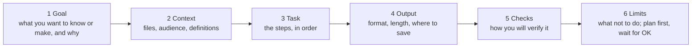
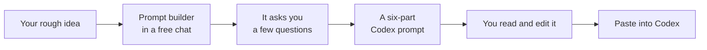

# Prompting guide

A good prompt is not clever wording. It is a clear brief: what you want,
what to use, what to hand back, and how you will know it is right. Codex
can only do what it understands, so a vague prompt gets a vague result, or
a confident wrong one.

## What makes a good prompt



| Part | Ask yourself | Example |
| --- | --- | --- |
| **1 Goal** | What do I want, and what is it for? | "...so I can present it in a 7-minute seminar talk" |
| **2 Context** | Which files? Who reads it? What do my words mean? | "Use data/survey.csv. 'International' means not from Japan." |
| **3 Task** | What are the steps? | "Remove names, then compare the two groups on each rating." |
| **4 Output** | What should I get back, and where? | "A one-page summary in outputs/summary.md and two bar charts." |
| **5 Checks** | How will I know it is right? | "Give me one number I can check by hand in Excel." |
| **6 Limits** | What must it not do? When should it stop? | "Do not invent quotes. Show me a plan first and wait for my OK." |

You do not need all six every time. For a quick question, Goal and Context
are enough. For anything that changes files or numbers, use all six.

## Before and after

Copy the **better** versions and change the parts in square brackets.

### Analysing a data file

Vague:

```text
analyse my data
```

Better:

```text
Goal: I want to know whether [international visitors] rate [Beppu] lower than [domestic visitors], for my seminar presentation.
Context: The data is [data/survey.csv]. [International] means [answers to "Where are you visiting from?" that do not start with "Japan"].
Task: Describe the data first, then compare the two groups on each 1-5 rating question.
Output: A table of means and the share answering 4 or 5, saved to outputs/results.csv, and one bar chart in outputs/.
Checks: Tell me how you treated blanks and duplicates, and give me one number to check by hand in a spreadsheet.
Limits: Do not change the original file. Show me a plan first and wait for my OK.
```

### A literature table from your notes

Vague:

```text
make a literature review about overtourism
```

Better:

```text
Goal: A table of the readings I have already collected on [overtourism in Japan], to plan my literature review.
Context: My notes are in [notes/], one file per reading.
Task: For each reading, record author (year), place studied, data, method and main finding.
Output: A table in outputs/literature.md, sorted by year, plus three gaps you notice across the readings.
Checks: Mark with [CHECK] anything you could not find in my notes.
Limits: Use only my notes. Do not add readings, authors or findings that are not there.
```

### Slides from your results

Vague:

```text
make slides
```

Better:

```text
Goal: A [7]-minute deck for a [seminar class] that presents my findings.
Context: My checked findings are in [outputs/findings.md]. The audience knows the topic but not my data.
Task: Propose an outline first: about one slide per minute, each title a full sentence stating the takeaway.
Output: After I approve the outline, one HTML deck in outputs/deck/ that I can open offline and save as a PDF.
Checks: List every number on the slides and where in findings.md it comes from.
Limits: No numbers, quotes or claims that are not in findings.md. No emoji, no gradients.
```

(With the [example skills](../skills/) installed, `$presentation-page` does
most of this for you.)

### Fixing an error

Vague:

```text
it doesn't work
```

Better:

```text
Goal: Get [scripts/coverage.py] to run.
Context: When I run it I get this error: [paste the full error message].
Task: Explain the error in plain English, then propose the smallest fix.
Output: The fix, and one sentence on what caused it.
Checks: Run the script again after the fix and show me that it works.
Limits: Change only what is needed to fix this error. Do not rewrite the script.
```

## Seven habits

1. **One task per prompt.** Big jobs become a plan of small steps.
2. **Name the files.** "data/survey.csv", not "my data".
3. **Define your words.** "International", "satisfied", "generates": say
   exactly what they mean.
4. **Say what done looks like:** the format, the length, where to save it.
5. **Ask for a plan first** whenever files or numbers will change.
6. **Ask how to check it,** every time.
7. **Correct, do not restart.** If the result is wrong, say what is wrong:
   "The chart should compare groups, not years."

## Make your usage last

Codex usage is limited on most plans, and most tightly on Free. Each message makes
Codex read files, think and run code, so an unclear task can use a lot.

| Habit | Why it saves usage |
| --- | --- |
| **One task per chat.** Start a **New chat** for each new job. | Long chats make Codex re-read everything that came before. |
| **Use Light effort for quick jobs,** High for analysis and slides. | Higher effort means longer thinking. |
| **Plan first, then approve.** | Fixing a wrong plan is cheap; redoing finished work is not. |
| **Keep the folder small.** Only the files the task needs. | Codex reads less to understand the project. |
| **Draft the prompt in a regular chat** (next section). | Claude and Gemini do not use your Codex allowance. In ChatGPT, use regular **Chat**, not **Work**: Work shares Codex's limits. |
| **Check with a spreadsheet,** not another Codex run. | A hand check is free and teaches you more. |
| **On Plus or higher: stay on GPT-6 Luna** for workshop tasks. | It is the most efficient model. Save the Astra model and the Max and Ultra effort levels for hard problems. |

## Let a chatbot write the prompt for you

You can use a regular chat (Claude, Gemini, or ChatGPT in **Chat** mode, not Work) to turn a rough idea
into a well-structured Codex prompt. The chatbot asks you questions, then
writes the prompt; you paste the result into Codex.



**Why it helps:** working out what you want is the hard part, and a chat
is a good place to think it through. It also saves your Codex usage for the
actual work.

**Two cautions:**

- The chatbot **cannot see your files**, so it may guess file names or
  columns. The prompt builder below tells it to use [placeholders] instead;
  fill them in yourself, or let Codex check them.
- **Do not paste private data into the chat.** Describe your data ("a
  survey with 120 answers, ratings 1 to 5"), do not paste it.

### The prompt builder

Copy everything in the box into a new chat in Claude, Gemini or ChatGPT,
then describe what you want in your own words.

```text
You are a prompt builder. Help me write one prompt for OpenAI Codex, an AI agent that works inside a folder on my computer: it can read and write files and run code there. I am a university student and may not know programming.

How to work with me:
1. Ask me questions one at a time, at most five in total, to understand: my goal and what it is for; which files Codex should use; what my key words mean; what I want back and where it should be saved; and how I will check the result.
2. If I am vague, offer two or three concrete options to choose from.
3. Then write the final Codex prompt with exactly these six labelled lines: Goal, Context, Task, Output, Checks, Limits.

Rules for the final prompt:
- Under 150 words, in plain English.
- Use [square brackets] for anything you do not know, such as file names or column names. Never guess them.
- Limits must include: do not change the original files; show a plan first and wait for my OK; never invent data, quotes or references.
- Checks must ask Codex to give me at least one result I can verify by hand.
- After the prompt, list the [placeholders] I still need to fill in.

Start by asking me your first question.
```

### No other chatbot? Ask Codex to interview you

```text
Before doing anything, interview me: ask me up to five questions, one at a time, about what I want, which files to use, what my key words mean, what the result should look like and where to save it, and how I will check it. Then write the task back to me as six separate labelled lines: Goal, Context, Task, Output, Checks and Limits. Limits must include: do not change my original files; show a plan first; never invent data, quotes or references. Checks must give me one result I can verify by hand. Wait for my OK before starting.
```

Next: with your own project, [04: Skills, Part A](../04-make-a-skill/#part-a-install-the-example-skills-5-minutes)
then [02](../02-your-project/); without one, a practice track:
[98](../98-present-your-work/) or [99](../99-follow-my-example/).
