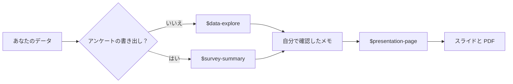

[English](README.md) · **日本語**

# 見本のスキル

ゼミの作業と就職活動（就活）のための、すぐに使えるスキルが4つあります。
1つのフォルダが1つのスキルです。中には、Codex が従うレシピの `SKILL.md` と、
必要なファイルが入っています。

| スキル | 渡すもの | 受け取るもの |
| --- | --- | --- |
| [`data-explore`](data-explore/SKILL.md) | どんな CSV や Excel のファイルでも、それと質問 | きれいにしたデータ、最大3つのグラフ、確認済みの数字が入った `outputs/findings.md`、手で確認するための数字1つ |
| [`survey-summary`](survey-summary/SKILL.md) | アンケートの書き出し（Google フォーム、Microsoft Forms） | 匿名のコピー、評価と選択式の質問の表、テーマ別の回答の引用、グラフ、`outputs/survey_summary.md` |
| [`presentation-page`](presentation-page/SKILL.md) | 分析結果メモ、アンケートの要約、または自分のメモ | 3つのテーマから1つを使った、1ファイルのスライド。オフラインで開けて、PDF に保存できます（[デザインガイド](presentation-page/references/design-guide.md)、[テンプレート](presentation-page/assets/deck-template.html)） |
| [`portfolio-page`](portfolio-page/SKILL.md) | 自分の履歴書やメモ、またはインタビュー | 本当のことだけを書いた `me/profile.md`。そのあと、英語（希望すれば日本語も）の1ページのポートフォリオサイト。GitHub Pages にそのまま公開できます（[文章ガイド](portfolio-page/references/writing-guide.md)、[テンプレート](portfolio-page/assets/site-template.html)）。[コース97](../97-portfolio-site/README.ja.md) で使います。 |

スキルはつなげて使えます。

自分のプロジェクトで使うには、**インストール**します。
[04：スキルを一歩ずつ（パートA）](../04-make-a-skill/README.ja.md#part-a-install-the-example-skills-5-minutes)
に従ってください。ファイルを自分で作ったり編集したりする必要はありません。
あなたが許可すると、Codex がコピーします。練習コース98と99には、
使うスキルがすでに入っています。

**スキルがしないこと：** 数字・引用・参考文献を作り出すこと。空欄や重複を
どう扱ったかを伝えずに分析すること。AI利用の注記を省くこと。
それでも、結果は自分で確認してください
（[03：確認と申告](../03-verify-and-disclose/README.ja.md) を見てください）。
