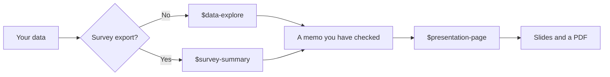

**English** · [日本語](README.ja.md)

# Example skills

Four ready-made skills for seminar work and job hunting. Each folder is one skill: a
`SKILL.md` recipe Codex follows, plus any files it needs.

| Skill | Give it | You get |
| --- | --- | --- |
| [`data-explore`](data-explore/SKILL.md) | Any CSV or Excel file and a question | Cleaned data, up to three charts, `outputs/findings.md` with checked numbers, and one number to verify by hand |
| [`survey-summary`](survey-summary/SKILL.md) | A survey export (Google Forms, Microsoft Forms) | An anonymous copy, rating and choice tables, themed quotes, charts and `outputs/survey_summary.md` |
| [`presentation-page`](presentation-page/SKILL.md) | A findings memo, survey summary or your notes | A one-file slide deck in one of three themes, which opens offline and saves as PDF ([design guide](presentation-page/references/design-guide.md), [template](presentation-page/assets/deck-template.html)) |
| [`portfolio-page`](portfolio-page/SKILL.md) | Your CV or notes, or an interview | `me/profile.md` with only true facts, then a one-page portfolio site in English (and Japanese if you want), ready for GitHub Pages ([writing guide](portfolio-page/references/writing-guide.md), [template](portfolio-page/assets/site-template.html)). Used in [track 97](../97-portfolio-site/). |

They chain together:

**Install them** for your own projects: follow
[04: Skills, Part A](../04-make-a-skill/#part-a-install-the-example-skills-5-minutes).
You do not create or edit any file yourself; Codex copies them after you
approve. The practice tracks 98 and 99 already include the skills they use.

**What they will not do:** invent numbers, quotes or references; analyse
without telling you how blanks and duplicates were handled; or leave out
the AI-use note. You still check the results (see
[03: Verify and disclose](../03-verify-and-disclose/)).
